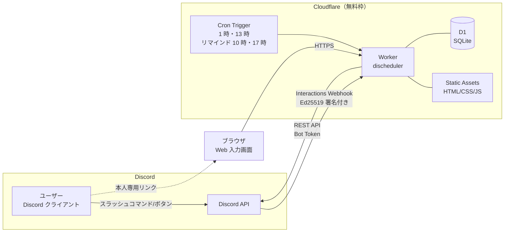
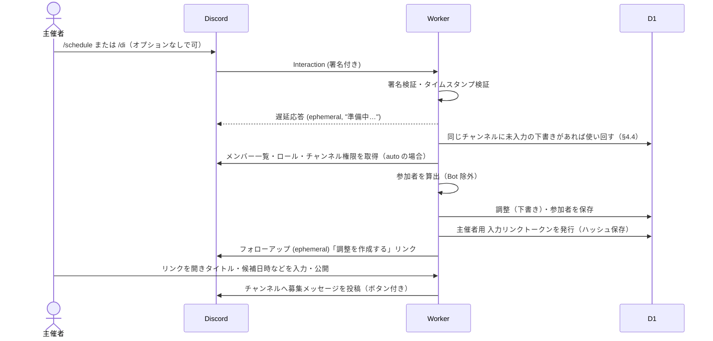
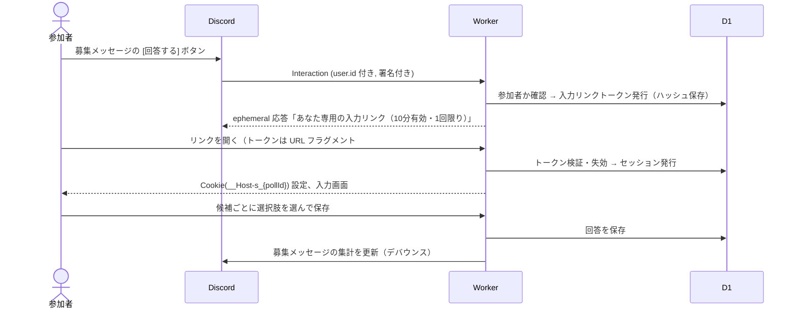
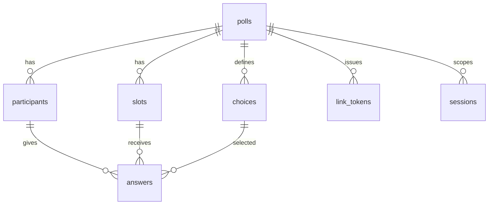
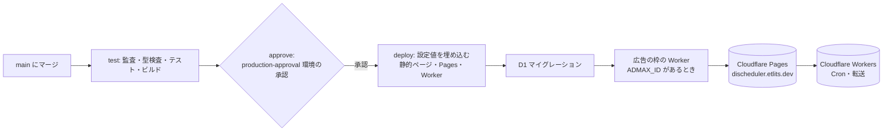

# DIscheduler 設計書

Discord のチャンネル（またはロール）のメンバー間で日程調整を行う Bot / Web アプリケーション。
Cloudflare Workers の無料枠のみで完結するサーバーレス構成とする。

- 版: 1.0（初版）
- 作成日: 2026-11-06
- 関連文書: [public/security.html](../public/security.html)（利用者向けセキュリティ方針。`/security` で公開）、[docs/security-design.md](./security-design.md)（セキュリティ設計詳細）、[SECURITY.md](../SECURITY.md)（脆弱性の報告窓口）

---

## 1. 目的とスコープ

### 1.1 目的
Discord 上の集まり（ゲーム会・勉強会・オフ会など）の日程調整を、外部サービス（調整さん等）へのアカウント登録や URL 共有なしに、Discord 内から開始・回答・確定まで行えるようにする。

### 1.2 要件と対応方針

| # | 要件 | 対応方針 | 実現性 |
|---|------|----------|--------|
| R1 | チャンネルメンバー／ロールメンバーが参加者として初期表示される | 作成時に Discord REST API でギルドメンバーを取得し、チャンネル閲覧権限またはロール所持で絞り込んで参加者リストを生成 | ◎（標準は Server Members Intent による自動抽出。手動選択も選べる。§5.3） |
| R2 | 主催者が簡単に候補日時を入力できる（HTML） | Workers Static Assets で配信する Web 画面。カレンダーで日付を複数選択 → 時間帯を一括適用 | ◎ |
| R3 | メンバーが簡単に予定を入力できる | Discord のボタン → 本人専用リンク（ログイン不要）→ 選択肢（既定は ○△×）をタップするだけの Web 画面。選択肢の組み合わせと数は主催者が変更できる（§6.9） | ◎ |
| R4 | 入力方法がわかりやすく、候補日時が見やすい | 表形式（候補×メンバー）＋集計＋最有力候補のハイライト。回答画面でも各候補の集計を見ながら入力できる。スマホ優先レイアウト | ◎ |
| R5 | 確定日時を Discord イベントとして登録 | Guild Scheduled Event API で作成（Bot に「イベントの作成」権限が必要） | ◯（任意機能。権限がなければスキップ） |
| R6 | Cloudflare Workers でサーバーレス完結・維持費ゼロ | Pages Free（Pages Functions）+ Workers Free（Cron Triggers）+ D1 Free のみ使用 | ◎（§9 で無料枠試算） |
| R7 | セキュリティ対策を徹底し、対策内容を公開 | 署名検証・最小権限・データ最小化・CSP 等を実装し、`/security` ページ（S6）とセキュリティ設計書で公開 | ◎ |

### 1.3 スコープ外（初版）
- 繰り返し予定、外部カレンダー（Google/Outlook）連携
- 複数ギルドをまたいだ調整
- ネイティブアプリ

---

## 2. 用語

| 用語 | 意味 |
|------|------|
| 調整（Poll） | 1 件の日程調整。タイトル・候補日時・参加者・回答を持つ |
| 主催者（Organizer） | 調整を作成したユーザー。候補編集・確定・削除ができる |
| 参加者（Participant） | 回答を求められるユーザー。作成時に自動抽出（`auto`）または主催者が選択（`manual`）し、主催者が増減できる |
| 候補（Slot） | 候補日時 1 件（開始・終了） |
| 選択肢（Choice） | 回答に使う記号と意味の組（既定は ○ 参加可／△ 未定／× 不可）。調整ごとに主催者が 2〜5 個で設定できる（§6.9） |
| 回答（Answer） | 参加者×候補 ごとに選んだ選択肢 1 つ |
| 入力リンク | 主催者・参加者の本人だけに一時表示される、短命（10 分）・使い捨ての Web 画面用リンク（§6.8） |

---

## 3. システム構成

### 3.1 全体構成図



### 3.2 採用技術

| 区分 | 技術 | 理由 |
|------|------|------|
| 実行環境 | Cloudflare Pages（Free。Pages Functions の advanced mode で Worker のコードをそのまま動かす）＋ Cloudflare Workers（Free。Cron と旧アドレスの転送） | 常駐プロセス不要。HTTP Interactions 方式なら Gateway 接続が不要。公開アドレスを `<プロジェクト名>.pages.dev` にすることで、`pages.dev` が Public Suffix List に載っているため、アドレスの直下に AdSense の所有確認や `ads.txt` を置ける（§6.10.1） |
| Discord 連携 | HTTP Interactions Endpoint + REST API | WebSocket 常駐が不要でサーバーレスと相性が良い |
| DB | Cloudflare D1（Free） | SQL・トランザクション・プリペアドステートメントが使える。書込上限が KV より大きい |
| 静的配信 | Cloudflare Pages の静的配信（`public/`） | 無料・同一オリジンで配信でき CSP を厳しくできる。`_routes.json` で、Pages Functions を動かすパス（`/discord/*`・`/api/*`・`/l`・`/p/*`）以外は静的ファイルとして配信し、`_headers` のヘッダーを付ける |
| 定期処理 | Cron Triggers（Worker `discheduler`。Pages は Cron に対応していないため） | **1 日 2 回（日本時間 1 時・13 時）だけ** 実行する。回答が入りやすい昼休み（12〜13 時）と終業後の夜の直後に反映するため。未反映の回答の変更がある募集メッセージの更新、締切を過ぎた調整の `closed` への変更。1 時の回は期限切れデータの削除も行う。ほかに、毎時 0〜4 分に 1 分おきに予定のリマインドだけを行う（主催者が決めた日時に送るため。§5.7） |
| 言語 | TypeScript | 型による入力検証の取りこぼし防止 |
| ルーティング | Hono | Workers ネイティブで軽量、依存が少ない |
| 入力検証 | Valibot | 軽量なスキーマ検証 |
| フロントエンド | 素の TypeScript（フレームワークなし）＋ Vite でビルド | 依存最小化・バンドル軽量化・サプライチェーンリスク低減 |
| CI | GitHub Actions | テスト・型検査・依存監査・CodeQL・デプロイ |

> 依存パッケージは「ランタイム依存は Hono と Valibot のみ」を原則とし、追加時はレビュー必須とする（§security-design 参照）。

### 3.3 Gateway を使わない理由
Discord Bot は通常 WebSocket（Gateway）に常時接続するが、Workers は常駐できない。本アプリはスラッシュコマンド・ボタン・モーダルのみで操作する設計とし、すべて HTTP の Interactions Webhook で受け取る。メンバー情報などは必要な時に REST API で取得する。

---

## 4. 利用フロー

### 4.1 調整の作成（主催者）



1. 主催者がチャンネルで **`/schedule`（または別名の `/di`）とだけ入力して実行** する。コマンド入力に慣れていない人でも始められるよう、オプションはすべて任意とし、何も指定しなければ次の既定値で下書きを作る。

   | オプション | 既定値（指定しない場合） | Web 画面（S2）での変更 |
   |------------|--------------------------|------------------------|
   | `title`（最大 100 文字） | 空欄（S2 で入力する）。空白や見えない文字だけの値も空欄として扱う | 可。**公開には必須** |
   | `members`（`auto`／`manual`） | `auto`（コマンドを実行したチャンネルを閲覧できるメンバー） | 可 |
   | `role` | なし | 可（指定するとそのロールのメンバーが参加者） |
   | `deadline` | 公開した時点から 7 日後 | 可 |

   - コマンドのオプションは、慣れた人が入力を省くための近道という位置づけで、すべて S2 で入力・変更できる。
2. Worker は 3 秒以内に「遅延応答（ephemeral）」を返し、メンバー取得等は `ctx.waitUntil` で継続する。
3. 主催者だけに見えるメッセージで「調整を作成する」リンクを返す。
4. Web 画面でタイトルと候補日時を入力し「公開」すると、チャンネルに募集メッセージ（埋め込み＋ボタン）が投稿される。タイトルが空のままでは公開できない。

### 4.2 回答（参加者）



- ［回答する］［集計を見る］を押したときの ephemeral 応答は、先頭で押した本人をメンションする（`allowed_mentions.users` は本人だけ）。本人にだけ見える応答なので、ほかの人には見えない。応答に気づきやすくするため。

- 参加者は Discord ボタンを押すだけで本人確認済みの入力画面に入れる（Discord アカウントでの追加ログイン不要）。
- **回答の受付期間**: 調整が存在している間は、締切を過ぎても、日時が確定した後も、参加者はいつでも回答を入力・変更できる。予定が変わったことを後から伝えられるようにするため。

  | 調整の状態 | 回答の入力・変更 | 画面の表示 |
  |------------|------------------|------------|
  | `draft`（未公開） | 不可（参加者にリンクを発行しない） | — |
  | `open`（募集中） | 可 | — |
  | `closed`（締切を過ぎた） | 可 | 「締切を過ぎています。回答の変更はできます」 |
  | `fixed`（確定） | 可 | 確定した候補を強調し、「〇月〇日 〇時に確定しています。予定が変わった場合は回答を変更してください」 |
  | `cancelled`・削除済み | 不可（データがない） | 「この調整は削除されました」 |

  - 締切は「この日までに答えてほしい」という目安で、過ぎても入力は止めない。締切はリマインドの対象と、画面・募集メッセージの表示に使う。
  - 確定後に回答を変更しても、確定した日時は自動では変えない（変更は主催者の判断）。主催者が気づけるよう、S4 に「確定後に回答を変更した人」を表示する（§6.5）。
  - 確定時点で未回答だった候補に後から答えた場合も、「未回答→○」のように変更として記録する（`answers.prev_choice_id` に空文字を入れる）。確定後は、回答の保存で送られなかった候補の回答を消さない。
  - 回答を変更しても、データの保持期間（§7.4）は延びない。
- 簡易回答として、Discord 上の [全部○] [全部×] のようなショートカットは提供しない（誤操作防止）。代わりに Web 画面に「すべて［先頭の選択肢］にする」「すべて［最後の選択肢］にする」ボタンを置く（既定の ○△× なら「すべて○」「すべて×」）。

### 4.3 確定（主催者）

1. 主催者が Web 画面の集計表で候補を選び「この日時で確定」。
2. オプションで「Discord イベントとして登録」にチェック（場所: ボイスチャンネル選択 or 自由入力）。
3. Worker が
   - 候補を確定済みにし（`slots.fixed_at`）、調整のステータスを `fixed` に更新
   - 募集メッセージを「確定: <t:UNIX:F>」に編集する
   - Guild Scheduled Event を作成（権限がなければスキップし、その旨を主催者に表示）
   - **チャンネルへのお知らせは、この時点ではしない**（下の 6. の［確定をお知らせする］でまとめて投稿する）
4. 主催者は S4 のまま、画面の上部に「確定しました」と表示する。
5. **1 つの調整で、複数の候補を確定できる**（例: 2 日に分けて開催する）。ほかの候補を確定しても、確定済みの候補はそのまま残る。確定した時刻・Discord イベント・お知らせの状態・予定のリマインドの記録は候補ごとに持つ（`slots.fixed_at`・`slots.discord_event_id`・`slots.announced_fixed`・`slots.day_reminded_at`。§7.2）。確定済みの候補をもう一度確定することはできない（「確定し直す」はない。変えたいときは取り消してから確定する）。
6. **確定の取り消し**: 主催者は S4 の［確定を取り消す］で、確定した候補を 1 つずつ取り消せる（`DELETE /api/polls/{id}/fix/{slotId}`）。Worker は
   - その候補の Discord イベントを削除する（すでに消えていれば何もしない）
   - その候補の「確定後に変更」の記録（`answers.prev_choice_id`）と、予定のリマインドを送った記録（`slots.day_reminded_at`）を消す
   - 募集メッセージを更新する。チャンネルへのお知らせはしない（［確定をお知らせする］でまとめて投稿する）
   - 確定した候補がなくなったら、ステータスを `open` に戻す（締切を過ぎていれば締切後として表示する）。データの削除時刻も締切から 6 ヶ月後に戻す（§9）
7. **確定のお知らせ**: 主催者は S4 の［確定をお知らせする］で、いま確定している日時と、前回のお知らせのあとに確定を取り消した日時を、1 つのメッセージにまとめてチャンネルに投稿する（`POST /api/polls/{id}/announce`）。
   - 取り消しを知らせるために、候補ごとに「前回のお知らせで確定日として知らせたか」（`slots.announced_fixed`）を覚え、投稿できたら、いまの確定の状態で書き換える。知らせる確定日も取り消しもなければ投稿しない（409）。お知らせ済みでも、確定日があればもう一度投稿できる
   - メンションは選べる。対象は公開時のお知らせ（§5.5）と同じで、参加者をロールで決めた調整はそのロール、それ以外は `@everyone`。通知が続かないよう、メンションは 1 つの調整につき 1 時間に 3 回まで（投稿できたときだけ数える）とし、超えたらメンションせずに投稿して主催者に知らせる。投稿そのものも 1 つの調整につき 1 時間に 10 回まで
   - 予定のリマインドを送る回が過ぎてから確定した日時は、お知らせのその日時に開始までの時間を添えてリマインドを兼ねる（§5.7）
   - 投稿に失敗したら、エラーにしてお知らせ済みの記録は書き換えない

### 4.4 コマンドとボタン

コマンドは `/schedule` と、その別名の `/di` の 2 つだけにする。

| コマンド | 内容 | 実行者 |
|----------|------|--------|
| `/schedule` | 新しい調整を作成（実行者が主催者になる）。オプションなしで実行できる | 許可されたチャンネルで発言・コマンド実行できる人なら誰でも（§5.4） |
| `/di` | `/schedule` の別名。オプションも処理もまったく同じ（短く打ちたい人向け。DIscheduler の頭文字） | 同上 |

管理・使い方は、コマンドではなく **`/schedule`（`/di`）の応答メッセージのボタン** から使う。応答は本人にだけ表示される（ephemeral）。

```
┌───────────────────────────────────────┐
│ 新しい日程調整の下書きを作りました。    │
│ [ 調整を作成する ]  ← 本人専用リンク    │
├───────────────────────────────────────┤
│ [作成した調整を管理] [使い方]                         │
└───────────────────────────────────────┘
```

| ボタン | 内容 | 使える人 |
|--------|------|----------|
| 調整を作成する | S2 を開く本人専用リンク（10 分有効・1 回限り） | 実行者 |
| 作成した調整を管理 | このサーバーで自分が主催する調整の一覧ページ（S9。§6.11）を開く本人専用リンク（10 分有効・1 回限り。ephemeral） | 実行者（主催する調整がなければ、その旨を表示） |
| 使い方 | 使い方の説明とセキュリティ方針（`/security`）へのリンク（ephemeral） | 実行者 |

- `/schedule list` のように半角スペースで区切る形（サブコマンド）にすると、Discord の仕様上 `/schedule` だけでは実行できなくなる。`/schedule` だけで作成できることを優先し、サブコマンドは使わない。
- 一覧・管理・使い方だけを見たい場合も `/schedule` を実行してボタンを押す。同じ人が同じチャンネルに、タイトルも候補も未入力の下書きをすでに持っている場合は、新しく作らずにその下書きを使い回す。そのため、ボタンだけを使う目的で何度実行しても下書きは増えず、作成数の上限（§5.4.2）にも数えられない。未入力の下書きは 3 日で自動削除される（§7.4）。
- 募集メッセージにも [回答する] [集計を見る] [使い方] のボタンを置く。
- 作った下書きの参加者がロールで決まっていない（`target_type` が `role` でない）ときは、応答に「参加者はロールで決めるのがおすすめです。…」と、作成画面の「参加者」か `role` オプションで選べることを添える。公開時のお知らせ（§5.5）と予定のリマインド（§5.7）の通知が、ロールがあればそのロールにだけ届き、なければ `@everyone` になるため。
- Bot をサーバーに追加したとき、または `/schedule` を初めて使ったときの応答に、使い方の短い説明を添える。
- `/di` は `/schedule` と同じ定義で別のコマンドとして登録し、Worker では同じ処理に振り分ける。管理者が連携サービス設定でチャンネルを指定する場合は、Bot 全体の設定にすれば両方のコマンドに適用される（コマンド単位で設定する場合は両方に同じ設定をする）。

---

## 5. Discord 連携詳細

### 5.1 Bot の登録
- インストールスコープ: `bot`, `applications.commands`（ギルドインストールのみ。ユーザーインストールは無効）
- Interactions Endpoint URL: `https://discheduler.etlits.dev/discord/interactions`（正式な公開アドレス `PUBLIC_ORIGIN`。§14）
- コマンドは Worker 自身が REST API（`PUT /applications/{id}/commands`）で登録する。Bot トークンを Cloudflare の外（GitHub など）に置かないため。定義のバージョン（ハッシュ）を D1 の `meta` テーブルに記録し、Interactions Endpoint URL の登録時の PING、各 Interaction、Cron のときに、バージョンが変わっていれば登録し直す 同じ実行環境（isolate）の中では、一度確かめたバージョンを覚えておき、Interaction のたびに D1 を読み直さない（PING と Cron のときは毎回確かめる）。

### 5.2 必要な Bot 権限（最小権限）

| 権限 | 用途 | 必須 |
|------|------|------|
| View Channels | 投稿先チャンネルの参照 | 必須 |
| Send Messages | 募集・確定メッセージの投稿 | 必須 |
| Embed Links | 埋め込み表示 | 必須 |
| Create Events | 確定日時の Discord イベント作成 | 任意（R5 を使う場合） |
| Manage Events | Bot が作成したイベントの編集・削除 | 任意 |

> **Administrator 権限は要求しない。** メッセージ内容（Message Content Intent）も不要のため要求しない。
> **「メッセージ履歴を読む」（Read Message History）も要求しない。** Bot を追加する前のメッセージ履歴も、追加したあとのメッセージも読まない（チャンネルのメッセージを取得する API は呼ばない。メッセージに触れるのは、Bot が自分で投稿したものの編集・削除だけで、その ID は投稿したときに控えたものを使う）。サーバーの @everyone にこの権限があれば Bot も受け継ぐが、読む処理がないため影響しない。

### 5.3 参加者の決定（R1）

参加者の決め方は **選択式** とし、調整ごとに S2 画面（または `/schedule`・`/di` の `members` オプション）で選ぶ。

| モード | 既定 | 内容 | 必要な設定 |
|--------|------|------|------------|
| `auto` | ◎ | チャンネル閲覧者またはロール所持者を自動抽出（下記手順） | Server Members Intent |
| `manual` | | 主催者が S2 画面でサーバーメンバーを検索・選択（Worker が `GET /guilds/{id}/members/search` を呼ぶ。§8.1 の `GET /api/polls/{id}/member-search`） | 不要 |

どちらのモードでも、自動抽出後に主催者が S2 画面で参加者を追加・削除できる。
Server Members Intent が無効のまま `auto` が選ばれた場合（API が 403 を返す）は、`manual` に自動で切り替えて主催者にその旨を表示する。

#### 5.3.1 サーバーの既定値

主催者が `/schedule`（`/di`）で `members`・`role` を指定しなかったときに使う参加者の決め方を、サーバーごとに決めておける。

| 既定値 | 参加者 |
|--------|--------|
| チャンネル（初期値） | コマンドを実行したチャンネルを閲覧できるメンバー |
| ロール | 指定したロールのメンバー |
| 手動 | 主催者だけが入った状態で始め、主催者が S2 で追加する |

- 決める優先順: コマンドのオプション ＞ サーバーの既定値 ＞ チャンネル。作成後も、下書きの間は主催者が S2 で変更できる。
- **設定できるのは「サーバー管理」（または管理者）権限を持つメンバーだけ。** `/schedule` の応答に、その権限がある人にだけ［サーバー既定値の設定］ボタンを出す。ボタンを押すと、本人にだけ見えるメッセージで、決め方の選択とロールの選択（Discord 標準のロール選択メニュー）を表示する。設定は Discord の中だけで完結し、Web 画面は使わない。
- 権限はボタン・選択のたびに、署名済みの Interaction に含まれる押した人の権限（`member.permissions`）で確かめる。
- 既定のロールが削除された・誰も持っていない場合は、チャンネルのメンバーを参加者にし、主催者にその旨を表示する。
- 最後に変更した人と時刻を記録し、設定画面に表示する（`guild_settings`。§7.2）。
- 設定画面では、保存済みのロールを本文に表示し、ロールの選択メニューでは選択済みの状態にしない（そのロールが削除されていると、Discord が画面の表示を受け付けないおそれがあるため）。
- すでにある未入力の下書きを使い回すとき（§4.4）は、その下書きの設定のままにする。
- **Discord イベントの場所の既定値**も、同じ設定画面で決められる。［イベントの場所を変更］を押すと Discord の入力フォーム（モーダル）が開き、場所を 1 行（100 文字まで）で入力する。保存した場所は、主催者が S4 で日時を確定するとき、「場所を入力」の欄に最初から入る（主催者はその場で書き換えられる）。空にして保存すると初期値の「Discord」に戻る。改行や見えない書式文字を含む値は保存しない。保存済みの場所は集計画面を開いた主催者にだけ返し、参加者には返さない（`guild_settings.event_location`）。
- **ボイスチャンネルを既定にもできる。** 同じ設定画面のチャンネルの選択メニュー（Discord 標準。ボイス・ステージのチャンネルだけ）で選ぶと、S4 で確定するとき「ボイスチャンネル」とそのチャンネルが最初から選ばれる（`guild_settings.event_channel_id`）。受け付けるのは、Discord が送るチャンネルの種類がボイス（2）かステージ（13）のときだけ。文字の場所を保存すると「場所を入力」が既定に戻り、ボイスチャンネルの既定は外れる（文字の場所の既定は、ボイスチャンネルを選んだあとも「場所を入力」に切り替えたときのために残す）。既定のチャンネルが削除されていれば、S4 では「場所を入力」を選んだ状態にする。保存済みのチャンネルは、ロールと同じ理由で、選択メニューでは選んだ状態にせず本文に表示する。

#### 自動抽出（`auto`）の手順

Discord には「チャンネルのメンバー一覧」API がないため、次の手順で算出する。

1. `GET /guilds/{guild_id}/members?limit=1000&after=…` でギルドメンバーを取得（ページング）
   - **Server Members Intent（特権インテント）を Developer Portal で有効化する必要がある**
2. 対象の決定
   - **ロール指定時**: `member.roles` に対象ロール ID を含むメンバー
   - **チャンネル指定時**: `GET /guilds/{id}/roles` と `GET /channels/{id}` の権限上書き（permission_overwrites）から、Discord 公式の権限計算アルゴリズムで `VIEW_CHANNEL` を持つメンバーを算出（スレッドの場合は親チャンネル、プライベートスレッドの場合は `GET /channels/{id}/thread-members`）
3. Bot アカウント（`user.bot = true`）を除外
4. 上限: 参加者 100 名（表の見やすさと Workers Free の CPU 時間 10ms を考慮）。超える場合はロール指定を案内

参加者以外が [回答する] を押した場合の挙動は、調整ごとに S2 で選ぶ（`polls.join_policy`）:
- `closed`（既定）: 「この調整の参加者ではありません」と ephemeral で返す
- `open`: 押した人がそのサーバーのメンバーで、かつ募集メッセージのチャンネルを閲覧できる場合のみ参加者として追加して回答可能にする（外部の人は Discord のサーバーに入っていないためボタン自体を押せない）

### 5.4 コマンドの利用範囲と作成権限

**コマンドを使えるチャンネルは、サーバー管理者が Discord 標準の「連携サービス」設定で指定する。そのチャンネルで誰にコマンドを打たせるかは、Discord のチャンネル権限（発言者の制限）に任せる。** アプリ独自の許可リスト・ロール指定・管理コマンドは作らない（アプリ側でサーバーごとに持つ設定は、参加者の決め方と Discord イベントの場所の既定値だけ。§5.3.1）。

| 決めること | 決める人 | 方法 |
|------------|----------|------|
| コマンドを使えるチャンネル | サーバー管理者 | Discord の連携サービス設定で、DIscheduler のコマンドを許可するチャンネルを指定 |
| そのチャンネルで誰がコマンドを打てるか | サーバー管理者 | Discord のチャンネル権限（「メッセージを送信」「アプリコマンドを使用」）で発言できる人を制限する。アプリ側では指定しない |
| 調整の主催者 | — | コマンドを実行できた人は誰でも作成でき、実行者がその調整の主催者になる |

- Discord 標準の機能を使う理由:
  - Discord 側で強制されるため、許可されていないチャンネルからのコマンドや、発言権限のない人のコマンドは **Worker に届かない**（アプリのバグで制限がすり抜けることがない）
  - 管理者が普段使っている画面でそのまま管理でき、Bot ごとの独自操作を覚える必要がない
  - アプリ側にサーバー設定を保存しないため、保存データが増えない
- スラッシュコマンドの `default_member_permissions` は未設定とし、導入直後は Discord の既定どおり全チャンネルで、そのチャンネルに発言できる人が使える。チャンネルの指定は管理者が §5.4.1 の手順で行う。
- 募集メッセージの [回答する] ボタンはコマンドではないため、この設定の影響を受けない（回答できるかどうかは参加者かどうかで判定する。§5.3）。
- 主催者以外が編集・確定・削除できないよう、アプリ側で認可チェックを行う（security-design E-2）。

#### 5.4.1 管理者向け設定手順（README・[使い方] ボタンに掲載）

1. Discord の「サーバー設定」→「連携サービス」→「DIscheduler」を開く
2. 「チャンネル」で「すべてのチャンネル」をオフにし、コマンドを使わせたいチャンネルを追加する
3. 「ロールとメンバー」は変更不要（`@everyone` のまま）
4. 指定したチャンネルで発言できる人を絞りたい場合は、そのチャンネルの「チャンネルの編集」→「権限」で「メッセージを送信」「アプリコマンドを使用」を許可するロールを設定する

> 「サーバー管理」権限を持つメンバーは、Discord の仕様上この設定にかかわらずコマンドを使える。

#### 5.4.2 作成数のレート制限

乱用や誤操作による大量作成を防ぐため、アプリ側で作成数を制限する（D1 のカウンタで判定。security-design D-2）。

| 単位 | 上限 | 超えた場合 |
|------|------|------------|
| ユーザーごと | 1 時間に 10 件 | 「作成数の上限に達しました。○分後に再度お試しください」と本人にだけ表示 |
| サーバーごと | 1 日に 100 件 | 同上（サーバー全体の上限である旨を表示） |
| 進行中の調整（下書き・募集中） | 1 チャンネルあたり 20 件 | 「進行中の調整が多すぎます。不要な調整を削除してください」と表示 |

### 5.5 募集メッセージの更新
- **公開時のお知らせ**: 公開して募集メッセージを投稿したら、続けて募集メッセージへの返信として「<タイトル> の募集を始めました。募集メッセージの［回答する］から入力できます。」を投稿し、メンションで通知する。
  - 参加者をロールで決めた調整（`target_type = 'role'`）は、そのロールをメンションする（`allowed_mentions.roles` はそのロールだけ）。ロールの設定で「このロールに対して@mentionを許可する」がオフのときは、Bot に「@everyone、@here、全てのロールにメンション」の権限がないと通知されない。
  - ロールのない調整（チャンネルのメンバー・手動）は、`@everyone` をメンションする（`allowed_mentions.parse` は `everyone` だけ）。Bot に同じ権限がないサーバーでは、`@everyone` の文字だけが出て通知されない。招待リンクではこの権限を求めず、通知するかはサーバー管理者が Bot の権限で決める。
  - 参加者を 1 人ずつメンションすることはしない（人数が多いとメッセージが長くなるため）。
  - 投稿し直し（［チャンネルに投稿し直す］［もう一度投稿する］）では知らせない。お知らせの投稿に失敗しても、公開は済ませる。
- Interaction トークンは 15 分で失効するため、募集メッセージは **Bot トークンで投稿し**、`channel_id` と `message_id` を保存して `PATCH /channels/{id}/messages/{id}` で更新する。
- **募集中・締切後（`open`・`closed`）**: 回答を保存したときに更新する。ただし回答保存のたびに更新すると Discord の API レート制限に触れるため、最終更新から 20 秒以内の保存では、その場では更新しない。代わりに、その保存のリクエストの中で `ctx.waitUntil` を使い、20 秒の区切りが過ぎた時点で 1 回だけまとめて更新する（後追いの更新）。後追いの更新が重なった場合は、D1 の `last_synced_at` を条件付きで書き換えて 1 回だけ実行されるようにする。間隔を 20 秒にしているのは、`ctx.waitUntil` で応答後に処理を続けられる時間（およそ 30 秒）に収めるため。
  - 募集メッセージがない（削除された）ときは `last_synced_at` を書き換えない（主催者の画面の「未反映の回答の変更」が 0 件に見えないようにするため）。
  - 公開は投稿の前に `polls.publishing_at` に処理中の時刻を入れて権利を取り、同時に公開されても募集メッセージを 1 件だけ投稿する（60 秒より古い取りかけは取り直せる）。
  - 締切を過ぎて `closed` にした調整は、回答の変更がなくても Cron のときに募集メッセージを「締切を過ぎました」に更新する。
  - 募集メッセージが Discord で削除された（更新時に 404）ときは、更新しようとしたメッセージの ID がまだ記録されている場合だけ `message_id` を空にし（投稿し直しで新しい ID に変わっていたら残す）、主催者の画面に［もう一度投稿する］を出す。メッセージがあるときも、会話に埋もれた場合などに［チャンネルに投稿し直す］で投稿し直せる（古いメッセージは削除する。1 分に 1 回まで）。
  - 後追いの更新が失敗したとき（Discord の一時的なエラーなど）は、次の回答の保存、主催者の［今すぐ更新］、1 日 2 回の Cron のどれかで反映される。
  - Cron は 1 日 2 回だけなので、短い間隔の追いつきには使わない。
- **確定後（`fixed`）**: 確定後の回答の変更はまれなため、回答を保存しても募集メッセージは更新せず、1 日 2 回（日本時間 1 時・13 時）の Cron でまとめて更新する。前回の更新から回答が変わった調整だけを対象にする。最新の状況は S3・S4 でいつでも見られる。
- **手動更新**: 主催者は S4 の［今すぐ更新］で、状態にかかわらず募集メッセージをすぐ更新できる（§6.5）。最終更新時刻（`polls.last_synced_at`）と、まだ反映していない回答の変更があるかを主催者の画面に表示する。
- メッセージには候補ごとの「参加できる」区分の選択肢の人数（既定では ○ の人数）と回答率のみを表示し、**誰が×かなど個人の回答はチャンネルに表示しない**（Web 画面で参加者のみ閲覧可）。
- 締切後・確定後も [回答する] [集計を見る] ボタンは残す（回答は変更できるため。§4.2）。確定後のメッセージは「確定: <t:UNIX:F>」と、確定した日時に「参加できる」区分の人数（1 日 2 回更新。更新時刻も添える）を表示する。

### 5.6 Discord イベント登録（R5）
`POST /guilds/{guild_id}/scheduled-events`

| フィールド | 値 |
|------------|----|
| `name` | 調整タイトル |
| `scheduled_start_time` / `scheduled_end_time` | 確定候補の開始・終了（ISO8601） |
| `entity_type` | `2`（VOICE）または `3`（EXTERNAL） |
| `channel_id` | VOICE の場合のボイスチャンネル |
| `entity_metadata.location` | EXTERNAL の場合の場所（最大 100 文字） |
| `privacy_level` | `2`（GUILD_ONLY） |
| `description` | 調整の説明（任意） |

失敗時（権限不足・過去日時など）は確定処理自体は成功させ、主催者にエラー理由を表示する。

### 5.7 予定のリマインド
確定した日時ごとに、主催者が決めた日時に、調整のチャンネルへリマインドを投稿する。主催者の［リマインド］（未回答者へのリマインド。§6.5）とは別のもので、確定したあとの操作は要らない。

- **送る日時（主催者が決める）**: S2 の「予定のリマインド」で、**予定の当日か前日**と、**時刻（0:00〜23:00 の 1 時間ごと）**を選ぶ。既定は**当日の 17:00**。時刻は調整のタイムゾーン（S2 で決める）の壁時計で決める（`polls.remind_day_offset`・`polls.remind_hour`。§7.2）。
  - 確定した日時が複数あれば、日時ごとに送る（1 つの調整で 1 回ではない）。
  - 送る日時が予定の開始より後になるとき（例: 当日 17:00 で、予定が 10:00 から）は送らない。終日の予定は、その日が終わるまでなら送る（当日 17:00 でも送る）。S4 では、確定した日時ごとに「リマインド: 11/19(木) 17:00」のように送る日時を表示し、送らないときは主催者に変え方を添える。
  - 計算は `reminderAt`（`src/shared/model.ts`）で、Worker と Web 画面で同じものを使う。夏時間の境目も、壁時計の時刻で決める。
- **実行のタイミング**: Worker の Cron（`0-4 * * * *`。毎時 0〜4 分）で、1 分おきに 5 回動かす。Cron の文字列で、ほかの処理（1 時・13 時）と分ける（`REMINDER_CRON`）。
  - 無料プランでは、Discord への送信（サブリクエスト）と D1 の問い合わせが、それぞれ 1 回の実行あたり 50 回までに限られる（§9）。1 回にまとめず 5 回に分けることで、1 回の実行あたりの数を抑えつつ、毎時合わせて 100 件まで送れるようにする。
  - これらの回は予定のリマインドだけを行い、募集メッセージの更新・締切の処理・削除・コマンドの登録はしない（それらは 1 時・13 時の回で行う。§3.2）。
  - Workers の無料枠では、Cron の実行もリクエストとは別に数えられ、1 日 120 回の実行は問題にならない。
- **対象の予定**: 確定した候補（`slots.fixed_at` があるもの）のうち、開始がこれから 50 時間以内（送る日時は、早くて前日の 0 時なので、開始の最大 48 時間前。夏時間の分を足す）、または終日でその日がまだ終わっていないもので、`status = 'fixed'`、その確定日時についてまだ送っていないもの。開始時刻の早い順に 200 件まで読み、調整ごとの設定で送る日時を計算して、過ぎているものだけに送る。1 回の実行で 20 件まで送り、残りは次の分の回で送る。確定した候補の開始時刻には索引がある（`idx_slots_fixed_start`）。
  - **送る日時を過ぎてから確定したとき**: 予定がまだ始まっていなければ、次の回で送る。それより先に［確定をお知らせする］（§4.3）を押したときは、お知らせのその日時に「<t:開始:R>に始まります」を添えてリマインドを兼ね、送ったことにする（あとの回で重ねて送らない）。
- **二重送信を防ぐ**: `slots.day_reminded_at` に、送った確定日時の開始時刻を記録する（§7.2）。送る前に `UPDATE slots SET day_reminded_at = ? WHERE id = ? AND (day_reminded_at IS NULL OR day_reminded_at != ?)` で権利を取り、書き換えた行が 1 のときだけ送る。
  - 前の回で送った調整は次の回で選ばれないので、5 回のどこかで 1 回だけ送られる。
  - 確定した候補の日時を S2 で変えたら、開始時刻が変わるので、新しい日時で改めて送る。確定を取り消した候補には送らない（記録も消すので、もう一度確定したら改めて送る）。送る日時の設定を変えても、送り済みの日時には送り直さない。
  - 送信に失敗しても記録は戻さない（同じ日時について送り直さない）。チャンネルが消えている・Bot が投稿できない（403・404）ときも、その調整を飛ばす。
- **メッセージ**: 募集メッセージへの返信（`message_reference`。`fail_if_not_exists: false`）として投稿する。募集メッセージがなければ返信にしない。日付で書く。時刻のある予定は Discord のタイムスタンプ記法（`<t:開始:f>`。見る人のタイムゾーンで日付と時刻を表示）、終日の予定は調整のタイムゾーンでの日付（例: 11/7(土)）。

  ```
  **<タイトル>** は <t:開始:f> からです。    （終日なら「は 11/7(土) です（終日）。」）
  <募集メッセージへのリンク>
  <メンション>
  ```

  - メンションは公開時のお知らせ（§5.5）と同じ。参加者をロールで決めた調整はそのロール、それ以外は `@everyone`。Bot に権限がないサーバーでは、文字だけが出て通知されない。
  - タイトルは Markdown をエスケープする。時刻は Discord のタイムスタンプ記法で、見る人のタイムゾーンで表示する。
- **ログ**: 1 回の実行ごとに、送った数・上限で次の回に回した数・失敗した数を残す（`{"event":"day_reminder","sent":3,"deferred":0,"failed":0}`）。5 回目でも回した数が残る時間帯が出てきたら、Cron の範囲（`0-4`）を広げる。
- Discord イベントを登録していれば（§5.6）、イベントに「興味あり」を押した人には、開始時に Discord からも通知が届く。こちらは届く人を Bot から決められないため、予定のリマインドとは別に扱う。

---

## 6. Web 画面設計

### 6.1 共通方針
- スマートフォン（Discord アプリ内ブラウザ）での操作を最優先。最小タップ領域 44px。
- 日本語 UI。日時の表示・入力は §6.7 のタイムゾーン規則に従う（例: `11/12(水) 20:00–22:00 JST`）。
- ライト／ダークモード対応（Discord の利用者はダークが多い）。
- 外部 CDN・外部フォント・解析タグは一切読み込まない（CSP で禁止。寄付はただのリンク。§6.10）。広告は LP・セキュリティ方針ページ・回答の完了画面（S3a）の、サイトから切り離した枠の中だけに出す（§6.10.1）。作成・回答入力・集計・公開完了・確定完了の画面には出さない。
- 色だけに頼らない（選択肢は記号＋色＋読み上げラベルで表示する）。
- 強調色は赤（ライト `#d32f2f`、ダーク `#ff6b6b`。CSS の `--emphasis`）。必須の印（「（必須）」）、公開に足りない項目の案内、操作を促す文（「選んだ N 日を候補にするには…」）に使う。ボタンなどの基本の色（アクセント色）とは分ける。

### 6.2 画面一覧

| ID | 画面 | URL | 利用者 |
|----|------|-----|--------|
| S0 | Bot の案内（LP） | `/`（英語版 `/en/`。§6.12） | 公開 |
| S1 | リンク検証（中継） | `/l#<token>` | 全員 |
| S2 | 調整の作成・編集（タイトル・候補日時・選択肢・参加者など） | `/p/{pollId}/edit` | 主催者 |
| S3 | 回答入力（各候補の集計つき） | `/p/{pollId}/answer` | 参加者 |
| S3a | 回答の完了（回答を保存したあとに移る。広告の枠つき。§6.4, §6.10.1） | `/answered#p={pollId}`（英語版 `/en/answered#p={pollId}`） | 参加者 |
| S4 | 集計・確定 | `/p/{pollId}` | 参加者・主催者（全員が全員の回答を閲覧可。確定操作は主催者のみ） |
| S5 | エラー（期限切れ・無料枠超過など） | —（各画面の中で表示） | 全員 |
| S6 | セキュリティ方針 | `/security`（英語版 `/en/security`） | 公開 |
| S7 | 公開完了 | `/p/{pollId}/done` | 主催者 |
| S9 | 作成した調整の一覧（このサーバーで自分が主催した調整。§6.11） | `/g/{guildId}/polls` | 主催者 |
| S8 | マニュアル（項目ごとに 1 ページ） | `/manual/`、`/manual/{項目}`（英語版 `/en/manual/`、`/en/manual/{項目}`） | 公開 |

- S0・S3a・S6・S8 は静的ページ（`public/index.html`、`public/answered.html`、`public/security.html`、`public/manual/*.html`）として Cloudflare Pages から配信する。JavaScript は使わず、アプリと同じ CSP を `public/_headers` で付与する。
- **検索結果での表示（S0）**: LP の `<title>` と `og:title` を「DIscheduler（Discord の日程調整 Bot）」、`og:site_name` と構造化データ（`WebSite` の `name`）を「DIscheduler」にする。正規 URL（`<link rel="canonical">`・`og:url`）と構造化データの `url` は、正式な公開アドレス（`PUBLIC_ORIGIN`）を `scripts/prepare-public.sh` がデプロイ時に埋め込む（Pages のデプロイごとの別名のアドレスが、検索結果に別のページとして出ないようにするため）。構造化データは実行されないデータなので、CSP（`script-src 'self'`）の対象にならない。Google は検索結果のタイトルを書き換えることがあるため、表示は保証されない。
- S8 のマニュアルは、項目（はじめに、サーバーに追加する、使えるチャンネルを決める、調整を作る、候補日時を入れる、回答の選択肢を変える、参加者を決める、公開する、回答する、集計を見て確定する、募集メッセージの更新、調整を管理・削除する、困ったときは）ごとに 1 ページとし、全ページに同じ目次（広い画面では左のサイドバー、狭い画面では本文の下。本文の上に「目次へ」のリンク）と、前後のページへのリンクを置く。ヘッダー・フッター・LP の「使い方」の下と、Discord の［使い方］からリンクする。項目を足すときは、全ページの目次と前後のリンクを直す。
- **利用者向けのセキュリティ方針は S6（`public/security.html`）を基準とする。** リポジトリの `SECURITY.md` は S6 へのリンクと脆弱性の報告窓口だけを載せる。
- LP の「サーバーに追加する」リンクの `client_id` は `__DISCORD_APPLICATION_ID__` と書いておき、デプロイ時に `scripts/prepare-public.sh` が環境変数 `DISCORD_APPLICATION_ID` の値に置き換える（§14.2）。

### 6.3 S2: 調整の作成・編集（主催者）

```
┌──────────────────────────────────┐
│ 新しい日程調整                     │
├──────────────────────────────────┤
│ タイトル（必須）                   │
│   [ 定例会                     ]   │
│ 説明（任意, 1000字）[          ]   │
│ タイムゾーン [Asia/Tokyo ▼]        │
├──────────────────────────────────┤
│ ① 日付をタップして選択（複数可）   │
│   ◀ 2026年11月 ▶                  │
│   日 月 火 水 木 金 土             │
│          [4] 5  6  7  8           │
│    9 10 [11][12] 13 14 15  ...     │
├──────────────────────────────────┤
│ ② 時間帯                          │
│   最近使った: [19:00–21:00] ...    │
│   開始 [20:00▼] 終了 [22:00▼]      │
│   [＋ 選択した日時を候補に追加]    │
├──────────────────────────────────┤
│ ③ 候補一覧 (3件)                  │
│   11/4(水) 20:00–22:00     [×]    │
│   11/11(水) 20:00–22:00    [×]    │
│   11/12(木) 20:00–22:00    [×]    │
├──────────────────────────────────┤
│ ④ 回答の選択肢 [変更]             │
│   ○ 参加  △ 未定  × 不可          │
├──────────────────────────────────┤
│ 参加者 (12名) [編集]              │
│   決め方: (●)自動 ( )手動  ロール[なし▼]│
│   参加者以外の回答: (●)不可 ( )追加して可│
│ 締切 11/11(水) 23:59 [変更]        │
│        [ 公開してチャンネルに投稿 ] │
└──────────────────────────────────┘
```

- 日付の複数選択 × 時間帯の一括適用で、10 候補でも数タップで作成可能。
- 日付の選び方は「1 日ずつ」と「範囲で選ぶ」を切り替えられる。範囲では、始まりの日と終わりの日をタップすると間の日（今日以降）をまとめて選ぶ。別の月に移ってから終わりの日を選んでもよい。「1 日ずつ」でも、パソコンでは Shift キーを押しながらクリックすると、直前に押した日からの範囲を選べる。［選択を解除］で選び直せる。
- 日付を選ぶと、カレンダーの下の案内と［＋ 選択した日時を候補に追加］ボタンの上の一文で、ボタンを押すと候補になることと選んだ日数を伝え、ボタンを目立たせる。選んだ日付を追加しないまま保存・公開しようとしたら確認ダイアログを出し、［キャンセル］でボタンの位置に戻す。
- 「最近使った」の時間帯のボタンは、押せる部品だと分かるよう立体的なボタンの見た目にする。狭い画面では見出し（「最近使った:」）の下にボタンを並べる。固定の時間帯のボタン（「よく使う」）は、使う時間帯がサーバーによってまちまちなので置かない。
- 開始・終了は「ラベル＋入力欄」を組にして並べる。1 行に収まる幅では横に、収まらない幅（560px 以下）では組ごとに 1 行ずつ縦に並べる。
- 日付の案内文の Shift + クリックの説明は、幅の広い画面（641px 以上）でだけ出す。
- 開始の時刻を決めると、終了の時刻はその 1 時間後に自動で入る（23 時台なら翌日 0 時台。終了はそのあと自由に変えられる）。
- 時刻の入力の時計マーク（選択画面を開くボタン）は、押せる部品だと分かるよう立体的なボタンの見た目にする。入力欄そのものは他の入力と同じ見た目。
- 「終日」チェックで時間なし候補も可。
- 候補上限 30 件。
- 公開後も候補の追加は可能（削除は回答済みの場合に確認ダイアログ）。
- 回答の選択肢は既定で ○△×。[変更] から組み合わせと数を変えられる（§6.9）。
- 参加者の決め方（`auto`／`manual`）・ロール・参加者以外の回答（`join_policy`、§5.3）・タイムゾーン（§6.7）もここで変えられる。決め方・ロールを変えると参加者が設定し直されるため、確認ダイアログを出す。
- 下書きの間は、ロールの欄の下に案内を出す。ロールを選んでいなければ「参加者は「自動」でロールを選んで決めるのがおすすめです。」と理由（公開時と予定のリマインドで、ロールのメンバーにだけ通知が届く。ロールがないと `@everyone` で通知する）を、選んでいれば「このロールにメンションして知らせます」を出す（§5.5、§5.7）。マニュアルの「参加者を決める」にも同じおすすめを書く。
- 公開後はタイトルを空にできない（募集メッセージの見出しになるため）。締切は変えたときだけ送り、過ぎた締切を保存し直しても止まらないようにする。締切は画面で分まで入力するので、保存も分単位にそろえ、比べるときも分単位で比べる。
- [公開してチャンネルに投稿] はタイトルと候補が 1 件以上あるときだけ押せる。押せないときは、ボタンの下に足りない項目を強調色で「タイトルと候補日時を入力してください。」（足りない項目だけ）と出し、その下に「公開するには、タイトルと候補日時（1 件以上）が必要です。」を出す。成功したら S7（公開完了）に移り、「チャンネルに募集を投稿しました」と、集計画面へのリンク、寄付リンク（§6.10）を表示する。

#### 6.3.1 最近使った時間帯
- 開始・終了の入力の上に、**そのサーバーで最近使った時間帯を新しい順に 3 件まで**ボタンで出す（「最近使った:」）。押すと開始・終了の時刻が入る。まだ使ったことがないサーバーでは出さない。
- 覚えるのは、候補日時の保存（`PUT /api/polls/:id/slots`）で**新しく追加した候補**の開始・終了の時刻（調整のタイムゾーンでの壁時計の時刻、`HH:MM`）だけ。終日の候補と終了のない候補は覚えない。すでにある時間帯を使うと先頭に移る。
- サーバー単位で保存する（`guild_recent_times`、§7.2）。同じサーバーの主催者どうしで共有されるが、**誰が入れたかは保存しない**。
- 返すのは候補日時を編集できる主催者にだけ（`GET /api/polls/:id` の `recentTimes`）。参加者には返さない。
- 保存値は JSON の配列。読むときに形式（`HH:MM`）を確かめ、崩れていれば空として扱う。画面ではテキストとしてだけ表示する。
- 最後に使ってから 6 ヶ月たつか、Bot がサーバーから外されたら削除する（§7.4）。

### 6.4 S3: 回答入力（参加者）

予定を入れるときの目安にできるよう、回答画面の各候補に **ほかの参加者の回答状況（集計）** を並べて表示する。集計を見るために S4 へ移動する必要はない。

```
┌──────────────────────────────────────┐
│ 定例会   締切 11/11(水) 23:59         │
│ あなた: @taro    回答 8/12 名  [↻ 更新]│
│ ○ 参加  △ 未定  × 不可   （凡例）     │
├──────────────────────────────────────┤
│ ┌ 11/11(水) ─────────── 日付ごとの枠 ┐ │
│ │ 20:00–22:00              [○][△][×]│ │
│ │ ○7 △1 ×0 未回答 4                 │ │
│ │ 22:00–23:00              [○][△][×]│ │
│ │ ○4 △2 ×2 未回答 4                 │ │
│ └────────────────────────────────────┘ │
│ ┌ 11/12(木) ─────────────────────────┐ │
│ │ 20:00–22:00              [○][△][×]│ │
│ │ ○2 △1 ×5 未回答 4                 │ │
│ └────────────────────────────────────┘ │
├──────────────────────────────────────┤
│ [すべて○] [すべて×]                   │
│ ひとこと（任意, 100字）[            ]  │
│ [ 集計表を見る ]       [ 保存する ]    │
├──────────────────────────────────────┤
│ ▸ みんなの回答（畳んだ表）             │
└──────────────────────────────────────┘
   [みんなの回答] を開いた例（行がメンバー、列が候補。横にスクロールできる）:
   メンバー │ 11/11 20:00 │ 11/11 22:00 │ 11/12 20:00
   @a       │ ○           │ △           │ ×
```

- **1 候補を 1 行に**（なるべく多くの候補を一目で見られるように）: 左に日時と集計、右に選択ボタンを並べる。候補ごとのカードの枠はやめ、1 つの枠の中に区切り線で並べる。狭い画面でボタンが入らないときは、ボタンだけ次の行に回る。
  - 同じ日に候補が 2 つ以上ある調整では、同じ日付（調整のタイムゾーンでの日付）の候補を 1 つの枠で囲み、枠の中は区切り線を引かない。日付は見出しの帯にせず（背景色の帯は文字のコントラストが低く読みにくいため）、枠の最初の行の時間帯の上に、時間帯と同じ濃さの太字で書く。2 行目からは時間帯だけを書く。読み上げでは、日付を一覧（`ol`）の名前で伝える。どの日も候補が 1 つの調整では、1 つの枠に区切り線で候補を並べ、行に日付と時間帯を書く。日付をまたぐ候補は、終わりの日付を残す（例: `23:00–11/13(金) 01:00`）。閲覧者のタイムゾーンが調整と同じなら、タイムゾーンの略号は付けない（§6.7）。
  - 選択ボタン（ラジオボタン）には記号だけを出す（指で押しやすい 44px 角は保つ）。名前は読み上げ（`aria-label`）とマウスを乗せたときの表示（`title`）で伝え、一覧の上に記号と名前の凡例を出す。ボタンの数と記号・名前は、その調整の選択肢（§6.9）に合わせて変わる。
- **集計の表示**
  - 日時の下に、選択肢ごとの人数と未回答の人数を小さく 1 行で表示する（横棒のグラフは出さない）。最有力候補の★は回答画面には出さない（集計画面 S4 だけで出す。§6.9.3）。誰も回答していない候補も、人数 0 で表示する。
  - 誰がどう答えたかは、候補の行ごとには出さず、画面のいちばん下に畳んだ［みんなの回答］の表（行がメンバー、列が候補。S4 の［メンバー別に表示］と同じ表）で見る。誰も回答していないときは出さない。参加者間で共有する範囲内（§6.6）。描き直しても開いた状態を保つ。
  - 集計には **保存済みの回答** を数える。自分の回答も保存した時点で集計に入る。保存前に選んだ内容は数えず、画面上で選び直しても集計の数字は変わらない（自分の入力で目安が動いて見えないようにするため）。
  - [集計表を見る] で S4 の集計表（メンバー別の表を含む）を開く。入力中の内容は保存するまで S3 に残る。
- **最初の回答者**：まだ誰も回答を保存していない調整では、画面のいちばん上（タイトルの上）に「あなたが最初の入力者です。」と表示する。回答を受け付けていないとき（公開前の下書きなど）は出さない。
- **保存したあと**：S3a（回答の完了）に移る。表示するのは「回答を保存しました」「あなたの回答は集計に反映されました。」と［集計画面を見る］（S4 へ）だけで、回答・名前・調整のタイトルは表示しない。S3a は静的ページで、サーバーの API を呼ばない。調整の ID はアドレスの `#` の後ろ（`/answered#p={pollId}`）に置くので、サーバーにも広告会社にも送られない（`public/assets/answered.js` が形式を確かめてから［集計画面を見る］のリンクを作る）。S3a には広告の枠を 1 つ置く（§6.10.1）。
- **集計の更新**
  - 画面を開いたとき、保存したとき、[↻ 更新] を押したとき、ほかのタブから戻ったとき（`visibilitychange`）に取得し直す。
  - 一定間隔での自動更新はしない（Workers 無料枠のリクエスト数を節約するため）。
- まだ誰も回答していない候補は「まだ回答がありません」と表示する。
- 保存後は画面に残り、集計に自分の回答が反映される。続けて S4 を見たい人は [集計表を見る] を押す。
- 締切後・確定後も、回答の入力・変更と集計の閲覧ができる（§4.2 の回答の受付期間）。確定後は確定した候補を強調し、上部に確定日時を表示する。
- 画面右上に表示タイムゾーンの切り替えを置く（§6.7）。
- 集計は `GET /api/polls/{id}` で回答画面の表示に必要な情報と一緒に取得する（§8.1）。参加者以外には返さない。

### 6.5 S4: 集計・確定

```
┌────────────────────────────────────────────┐
│ 定例会   回答 9/12 名                        │
├───────────────┬───┬───┬───┬──────┬───────┤
│ 候補           │ ○ │ △ │ × │ 未回答│       │
├───────────────┼───┼───┼───┼──────┼───────┤
│★11/11(水)20:00│ 8 │ 1 │ 0 │  3   │[確定] │
│ 11/4(水) 20:00│ 5 │ 2 │ 2 │  3   │[確定] │
│ 11/12(木)20:00│ 3 │ 1 │ 5 │  3   │[確定] │
└───────────────┴───┴───┴───┴──────┴───────┘
 [ メンバー別に表示 ▼ ]
   (候補×メンバーのマトリクス。横スクロール、名前列固定。
    参加者全員が全員の回答とひとことを閲覧できる)
 未回答: @a @b @c   [未回答者にリマインド]
 ─ 主催者だけに表示 ─────────────────────────
 チャンネルの募集メッセージ
   最終更新: 11/10(火) 13:00
   未反映の回答の変更: あり（2 件）   [今すぐ更新]
   次の自動更新: 11/11(水) 1:00
```

- 表の列はその調整の選択肢（§6.9）ごとに並ぶ（上の図は既定の ○△× の場合）。
- 並び順: 日時順／点数の高い順を切替。★は最有力候補で、「不可」区分の人数が最少 → 点数の合計が最大 → 「参加できる」区分の人数が最多、の順で決める（§6.9.3）。
- **募集メッセージの更新状況**（主催者だけに表示）
  - 最終更新時刻: 募集メッセージを最後に更新した時刻（`polls.last_synced_at`）。
  - 未反映の回答の変更: 最終更新より後に保存・変更された回答の件数（`answers.updated_at > polls.last_synced_at`）。0 件なら「最新です」と表示し、［今すぐ更新］は押せない。
  - 次の自動更新: 次の 1 時か 13 時（日本時間。閲覧者のタイムゾーンで表示。§5.5）。募集中・締切後は、回答の保存時にも自動で更新される。
  - ［今すぐ更新］: 押すとその場で募集メッセージを更新し、最終更新時刻を書き換える。未反映の回答がなくても押せる（締切を過ぎた表示への切り替えなど、回答以外の理由でメッセージが古いことがあるため）。Discord の API の回数制限を守るため、同じ調整で 1 分に 1 回まで（サーバー側でも制限）。
  - S2 の上部にも最終更新時刻と［今すぐ更新］を置く。
- [確定] と [リマインド] は主催者にのみ表示（サーバー側でも認可）。確定すると S4 のまま上部に「確定しました」と表示する（§4.3）。
- 確定後に回答を変更した人がいれば、確定した候補の行に「確定後に変更: @a（○→×、11/10 21:05）」のように表示する。変更は候補ごとに、その候補を確定した時点から数える。Discord への通知はしない（通知が増えすぎないようにするため）。
- 確定した候補は複数にできる（§4.3）。確定していない候補には［確定］、確定済みの候補には［確定を取り消す］を、日時の下に並べる（狭い画面でも横にスクロールせずに押せるように）。［確定を取り消す］は確認のダイアログを出してから取り消す。
- 確定した候補か、お知らせしていない取り消しがあれば、「確定のお知らせ」の欄（主催者だけ）に、確定した日時・取り消した日時・まだお知らせしていない変更の件数と、メンションの選択、［確定をお知らせする］を置く（§4.3）。
- 確定した候補の日時を S2 で変えたときは、登録済みの Discord イベントの日時も合わせて変える。
- 調整を削除したときは、登録済みの Discord イベントも削除する。
- 確定後の募集メッセージの「確定した日時に参加できる人数」は、1 日 2 回（日本時間 1 時・13 時）まとめて更新する（§5.5）。
- リマインドは未回答者のみメンションして 1 回投稿（同一調整で 12 時間に 1 回まで）。日時を確定したあとはリマインドできない。

### 6.6 回答の公開範囲
- 個人ごとの回答（選んだ選択肢）とひとことコメントは **その調整の参加者全員（と主催者）に公開** する（S4 のメンバー別表示）。回答を共有すること自体がこのツールの目的であり、参加者間の共有は仕様とする。
- S3 画面に「あなたの回答は、この調整の参加者全員に表示されます」と明記する。

#### 外部の人から見えないようにする仕組み

「外部の人」とは、その調整の参加者・主催者 **以外のすべての人** を指す（インターネット上の第三者、同じサーバーにいても参加者でない人、別の調整の参加者、参加者から外された人を含む）。

| 経路 | 対策 |
|------|------|
| URL を直接開く・URL を推測する | 画面と API はすべてセッション必須。調整 ID だけでは何も表示されない（ログイン画面もなく「リンクの有効期限が切れています」と表示するのみ）。調整 ID は 128bit ランダム |
| 公開・共有用リンク | **作らない**。誰でも見られる閲覧 URL・埋め込み・CSV エクスポート機能は提供しない |
| 入力リンクの取得 | Discord の署名付き Interaction で、押した本人が参加者であると確認できた場合のみ、本人にしか見えないメッセージ（ephemeral）で発行。10 分・1 回限り |
| 別の調整のセッションで覗く | セッションは調整 1 件に限定。他の調整の API は 403。主催者の調整一覧（S9）のセッションは、そのサーバーで本人が主催した調整の一覧だけを扱い、調整を開くときは主催者本人と確かめてから調整ごとのセッションを発行する（§6.11） |
| 参加者から外された人 | 外した時点でその人のセッションを即時削除し、以後リンクも発行しない |
| 調整が削除された後 | データを物理削除し、セッションも同時に削除 |
| チャンネルの募集メッセージ | 候補ごとの「参加できる」区分の人数と回答率のみ。個人名と回答の組み合わせは出さない |
| 確定のお知らせ・Discord イベント | 確定日時と、ロール（なければ `@everyone`）へのメンションのみ。個人ごとの回答は載せない。Discord イベントは `GUILD_ONLY`（サーバー内限定） |
| 検索エンジン・キャッシュ | `X-Robots-Tag: noindex`、`Cache-Control: no-store`。CDN や共有キャッシュに回答を残さない |
| Bot の開発・運用者 | 運用者向けの閲覧画面は作らない。ログに回答内容・表示名を出力しない |

### 6.7 タイムゾーン

| 対象 | 既定値の決め方 | 変更 |
|------|----------------|------|
| 調整のタイムゾーン（候補日時を入力する基準） | 主催者が初めて S2 を開いたときの **ブラウザのタイムゾーン**（`Intl.DateTimeFormat().resolvedOptions().timeZone`）。取得できない・不正な値なら `Asia/Tokyo` | 主催者が S2 のタイムゾーン選択で変更可（変更すると `timezone_set = 1`） |
| 閲覧者ごとの表示タイムゾーン | 閲覧者の **ブラウザのタイムゾーン**。取得できなければ `Asia/Tokyo` | S3/S4 画面右上のタイムゾーン選択で変更可。選択値は閲覧者のブラウザ（localStorage）にのみ保存し、サーバーには保存しない |

- Discord の Interaction にはユーザーのタイムゾーン情報が含まれない（`locale` は言語のみ）ため、タイムゾーンの判定はブラウザで行う。
- 閲覧者の表示タイムゾーンが調整のタイムゾーンと異なる場合は、両方を併記する（例: `11/12(水) 20:00 JST（あなたの時刻: 11/12(水) 12:00 CET）`）。同じ場合は、候補の日時にタイムゾーンの略号（JST など）を付けない（例: `11/12(水) 20:00`。回答画面などで候補の行を短くするため）。回答画面（S3）では、候補の一覧の上に、日時のタイムゾーンを一度だけ書く（例: 「日時はすべて日本標準時（UTC+9）で表示しています。」。違う場合は「候補の日時は調整のタイムゾーンの日本標準時（UTC+9）、「あなたの時刻」は中央ヨーロッパ時間（UTC+1）で表示しています。」）。名前はブラウザの `Intl` が返すもの。UTC からの差は候補の日時の時点のものを出し、候補が夏時間の切り替えをまたいで差が変わるときは、差を書かず名前だけにする。終日の候補だけの調整では「あなたの時刻」を出さないので、閲覧者のタイムゾーンが違っても、調整のタイムゾーンだけを書く。
- タイムゾーンの選択欄（S2 の調整のタイムゾーン、S3・S4 の表示タイムゾーン）は、文字を入れて一覧を絞り込める入力欄にする（WAI-ARIA の combobox。矢印キーと Enter でも選べる）。IANA 名（`Asia/Tokyo`、`New York` のように `_` を空白にしたものも可）、日本語の名前（ブラウザの `Intl` が返す「日本標準時」など）、UTC からの差（`+9`、`UTC-5`）で探せる。空白で区切った語は、すべてを含むものに絞る。一覧にないものは選べず、選ばずに離れると元の値に戻す。
- サーバー側は日時をすべて UTC の UNIX 秒で保存・処理し、タイムゾーンは IANA 名（例 `Asia/Tokyo`）で保存する。受け取ったタイムゾーン名は `Intl.supportedValuesOf('timeZone')` に含まれるかで検証する。
- Discord のメッセージ内の日時は `<t:UNIX:F>` 形式で書くため、Discord が各ユーザーの端末のタイムゾーンで自動表示する。
- Discord イベントは UTC で登録するため、タイムゾーンによるずれは生じない。

### 6.8 リンク中継（S1）の仕組み
1. ephemeral メッセージのリンク: `https://<domain>/l#t=<token>`
   - トークンを**フラグメント**に置くことで、サーバーログ・Referer・プロキシに残らない。
2. S1 の JS がフラグメントを読み取り、`history.replaceState` で URL から即座に消去した上で `POST /api/session` に送信。
3. サーバーはトークンを検証・失効し、`__Host-s_{pollId}` Cookie を発行して、トークンの用途（`link_tokens.purpose`）に応じた画面へリダイレクトする。

| 用途 | 発行するきっかけ | 移る画面 |
|------|------------------|----------|
| `edit` | `/schedule`・`/di` の［調整を作成する］ | S2 |
| `answer` | 募集メッセージの [回答する] | S3 |
| `view` | 募集メッセージの [集計を見る] | S4 |

- 主催者の調整一覧（S9）のリンクは別の表（`list_tokens`）で発行し、同じ中継ページ（`/l`）でサーバー単位のセッション（`list_sessions`、Cookie `__Host-l_{guildId}`）に交換して S9 に移る（§6.11）。
- 1 つのセッションは 1 つの調整だけに有効（§8.1）。Cookie の名前に調整 ID を含め、複数の調整を同じブラウザで同時に開けるようにする（同じブラウザで別の Discord アカウントとして同じ調整を開くと、後から開いた側に置き換わる）。S2・S3・S4・S7 の間は、同じ調整であればセッションのまま行き来できる（参加者のセッションで S2 は開けない）。

### 6.9 回答の選択肢のカスタマイズ

主催者は調整ごとに回答の選択肢の **組み合わせと数** を変更できる。既定は ○（参加）・△（未定）・×（不可）の 3 つ。

#### 6.9.1 選択肢の設定項目

| 項目 | 内容 | 制約 |
|------|------|------|
| 記号 | ボタンと表に出す短い記号（例: ◎ ○ △ × ？） | 1〜2 文字（書記素単位）。改行・制御文字・双方向制御文字・Discord のカスタム絵文字記法（`<:name:id>`）は不可 |
| 名前 | 記号の意味（例: 参加、たぶん参加、未定、不可） | 1〜10 文字。同じ調整の中で重複不可 |
| 区分 | `ok`（参加できる）／`maybe`（未定・条件付き）／`ng`（参加できない） | 集計・★の判定・チャンネル表示に使う。`ok` と `ng` はそれぞれ 1 つ以上必須 |
| 点数 | 最有力候補の判定に使う重み | 0〜10 の整数。既定値は区分から自動で入る（ok=4、maybe=2、ng=0） |
| 色 | 表示色 | 区分ごとの固定パレット（緑・黄・赤など）から選ぶ。任意の色コードは受け付けない |
| 並び順 | ボタンと表の列の順 | ドラッグまたは上下ボタンで変更 |

- 選択肢の数は **2〜5 個**。
- 入力値は他の入力と同じく、スキーマとサーバー側で検証する（security-design §4.4）。

#### 6.9.2 用意するひな形

S2 の [変更] を押すと、ひな形から選ぶか、自分で編集できる。

- ひな形を選んだときは、いまの選択肢の ID を並び順のまま引き継ぐ（1 番目は 1 番目に、2 番目は 2 番目に）。回答は付いたまま残り、ひな形のほうが選択肢が少ないときは、余った選択肢の回答の移し先を選ぶ（§6.9.4）。

| ひな形 | 選択肢（記号 名前／区分／点数） |
|--------|-------------------------------|
| 標準（既定） | ○ 参加／ok／4、△ 未定／maybe／2、× 不可／ng／0 |
| 2 択 | ○ 参加／ok／4、× 不可／ng／0 |
| 4 段階 | ◎ ぜひ参加／ok／5、○ 参加できる／ok／4、△ 未定／maybe／2、× 不可／ng／0 |
| 時間の条件つき | ○ 参加／ok／4、遅 遅刻／maybe／2、早 早退／maybe／2、× 不可／ng／0 |
| 自分で作る | 上のどれかをもとに、記号・名前・区分・点数・色を編集し、追加・削除する |

```
┌──────────────────────────────────┐
│ 回答の選択肢                       │
│ ひな形: [標準 ▼]                   │
├──────────────────────────────────┤
│ ≡ [○ ] [参加    ] [参加できる▼] 2 [削除]│
│ ≡ [△ ] [未定    ] [未定      ▼] 1 [削除]│
│ ≡ [× ] [不可    ] [参加できない▼] 0 [削除]│
│ [＋ 選択肢を追加]（最大 5 個）      │
├──────────────────────────────────┤
│ プレビュー: [○ 参加][△ 未定][× 不可] │
│                 [ キャンセル ][ 保存 ] │
└──────────────────────────────────┘
```

#### 6.9.3 集計と最有力候補（★）
- 表には選択肢ごとの人数を並べ、区分ごとの合計も出す。
- 点数の合計 = Σ（その候補で各選択肢を選んだ人数 × 選択肢の点数）。未回答は数えない。
- ★の判定順:
  1. `ng` 区分の人数が最も少ない
  2. 点数の合計が最も大きい
  3. `ok` 区分の人数が最も多い
  4. それでも同じなら日時が早い候補
- チャンネルの募集メッセージには候補ごとの `ok` 区分の人数と回答率だけを表示する（§5.5）。

#### 6.9.4 公開後の変更
回答が集まった後に選択肢を変えると、回答の意味が変わってしまうため、次のルールにする。

| 操作 | 回答がまだない場合 | 回答がある場合 |
|------|-------------------|----------------|
| 記号・名前・色・並び順の変更 | 可 | 可（回答はそのまま。変更した時刻を `polls.choices_changed_at` に残し、それより前に回答した人の S3 の上部に「選択肢が変更されました」と表示。参加者が［確認しました］を押すまで表示し続ける（`participants.choices_ack_version`）） |
| 区分・点数の変更 | 可 | 可（確認ダイアログを出し、集計と★を再計算） |
| 選択肢の追加 | 可 | 可（既存の回答はそのまま） |
| 選択肢の削除 | 可 | その選択肢を選んだ回答の **移し先** を主催者が選ぶ（例: 「たぶん参加」→「未定」）。移し先を選ばずに削除はできない |

- どの変更も主催者だけが行え、サーバー側で認可する。
- 選択肢の変更（主催者）は、締切後・確定後はできない。回答の意味が途中で変わらないようにするため。参加者の回答の変更は締切後・確定後もできる（§4.2）。
- 変更時は `polls.choices_version` を 1 増やし、回答画面を開いている参加者が古い選択肢で保存しようとした場合は 409 を返して画面を再読み込みさせる。

### 6.10 寄付リンク

運営費（無料枠を超えたときの有料プラン代、月 5 ドル程度）をまかなうため、寄付リンクを置く。広告は今は出していない（§6.10.1）。

| 置く場所 | 表示 |
|----------|------|
| S0（LP） | 「運営の支援」の欄と、フッターのリンク |
| S7（公開完了） | 完了メッセージの下に 1 行（「DIscheduler は無料で運営しています。役に立ったら、コーヒー 1 杯分の支援をいただけるとうれしいです。」と [コーヒーを 1 杯おごる]） |
| S3a（回答の完了） | ［集計画面を見る］の下に、S7 と同じ 1 行 |
| 確定のお知らせの投稿後（S4） | 「確定のお知らせをチャンネルに投稿しました」の下に、S7 と同じ 1 行 |
| 調整の削除後 | 「調整を削除しました」の下に、S7 と同じ 1 行 |
| S5（無料枠超過のエラー） | 超過の説明の下に 1 行（§9.1） |

- 置かない場所: S3（回答入力）・S4（集計）、Discord のチャンネルに投稿するメッセージ。参加者の操作の邪魔をせず、チャンネルに宣伝が流れないようにするため。
- 完了の画面（S3a・S7・確定のお知らせの投稿後・削除後）の寄付リンクは、コーヒーカップの絵（Lucide の coffee。インラインの SVG で、外部の画像は読まない）を添えた枠で囲み、［コーヒーを 1 杯おごる］をカップと同じ暖かい色のボタンにして目立たせる。静的ページ（`public/answered.html`）とアプリ画面（`donationLine`）で同じ形・同じスタイル（`public/assets/site.css` の `.support-card`）を使う。
- 寄付は任意で、寄付の有無で機能は変えないことを、リンクの近くに書く。
- 支援サービスが Ko-fi のとき（`DONATION_URL` が `https://ko-fi.com/` で始まるとき）は、リンクの近くに「支援は Ko-fi（海外の支援サービス）で受け付けています。画面は英語ですが、金額を選んで、PayPal で支払えます。」を添える（LP の「運営の支援」欄と完了の画面）。アプリ画面は `src/shared/text.ts` の `donationNote`、静的ページは `scripts/prepare-public.sh` の `__DONATION_NOTE__` で入れる（文は両方そろえる）。
- 外部の支援サービスのボタンやウィジェット（スクリプト・iframe・画像）は埋め込まず、自前のボタンからの **ただのリンク** にする。CSP を緩めず、`Referrer-Policy: no-referrer` により、どの画面から来たかも支援サービスに送らない。
- リンク先の URL は GitHub の Environment variable `DONATION_URL` で設定する。
  - 静的ページ（S0・S3a・S6）: デプロイ時に `scripts/prepare-public.sh` が切り替える。
    - `<!-- donation:start -->` ～ `<!-- donation:end -->`: 寄付リンクがあるときだけ残す（LP の「運営の支援」欄、フッターのリンク、FAQ の支援の一文、回答の完了画面の 1 行、セキュリティ方針の寄付リンクの説明）
    - `<!-- no-donation:start -->` ～ `<!-- no-donation:end -->`: 寄付リンクがないときだけ残す（必要になったときに使う）
    - 目印のコメントは公開するページから取り除く。置き換え漏れがあればデプロイを止める。
  - アプリ画面（S4・S5・S7・削除後）: Worker の環境変数として渡し、未設定なら寄付の行を表示しない。
  - 後から `DONATION_URL` を設定・変更・削除したときは、GitHub の Actions →「Deploy」→「Run workflow」で `main` を再デプロイすると反映される。
  - `https://` で始まり、決まった文字だけでできた URL かを確かめてから使う（置換や HTML の書き換えを防ぐ）。
- 支援サービスは Ko-fi を使い、受け取りは PayPal だけにする（Stripe は登録時に住所などの公開を求められるおそれがあるため使わない）。そのため、Ko-fi の説明ではクレジットカードで払えるとは書かない。文言は Ko-fi の「コーヒー 1 杯分の支援」に寄せ、LP と完了の画面のボタンは［コーヒーを 1 杯おごる］にする。無料枠超過の画面（S5）は、困っている人に向けた画面なので［運営を支援する］のままにする。サービス名は固定の文に書かず、Ko-fi の説明（上記）で伝える（サービスを替えたときに文が食い違わないようにするため）。

---

#### 6.10.1 広告
**今は広告を出していない。** 忍者AdMax では不適切に見える広告が出たため、使うのをやめた（GitHub の `ADMAX_ID` を消し、広告の枠を出さない）。広告の枠の仕組みは、別の広告ネットワークに替えるときのために残してある。以下は、使っていたときの設計。

運営費の足しにするため、LP（S0）・セキュリティ方針ページ（S6）・回答の完了画面（S3a）に広告を 1 枠ずつ出す。配信は忍者AdMax（独自ドメインがなくても使え、事前の審査がない）。

- **出す場所**：LP の「使い方」の下、セキュリティ方針ページの末尾、回答の完了画面（S3a）の［集計画面を見る］の下だけ。作成・回答入力・集計・公開完了・確定完了の画面（S1〜S5・S7）と、Discord に投稿するメッセージには出さない。入力の邪魔をしないためと、回答や名前が出る画面に広告を並べないため。S3a は回答や名前を表示しない静的ページなので、広告の枠を置く。
  - S3a は回答を保存した人だけが通る完了画面で、Google AdSense の規約が広告の掲載を認めない画面（運営者のコンテンツがない完了画面など）に当たる。AdSense を使う場合も、S3a には AdSense の広告を出さない（忍者AdMax の枠だけ）。
- **別オリジンで切り離す**：広告の枠は本体とは別の Worker `discheduler-ads`（`https://ads.etlits.dev/frame`。`ads/`）で配信し、本体のページに iframe で埋め込む。本体（`discheduler.etlits.dev`）とはオリジンが違うので、同一オリジンポリシーで切り離される。
  - 本体と広告の枠は、同じ `etlits.dev` の下にあるので同じサイト（same-site）として扱われる（以前の `discheduler-ads.etlits.workers.dev` は `workers.dev` が Public Suffix List に載っているため別のサイトだった）。そのため次の 3 点で切り離しを保つ。
    - 本体の Cookie はすべて `__Host-` 付き（`Domain` なし・`Path=/`・`Secure`）なので、広告の枠から読めず、`etlits.dev` 全体に向けた同名の Cookie で上書きもされない。
    - 本体の API は書き込みのたびに `Origin` の完全一致（`ads.etlits.dev` からは通らない）と CSRF トークンを求め、CORS のヘッダーを返さないので、広告の枠のスクリプトから本体のデータは読めず、変更もできない。
    - 広告会社が `etlits.dev` 全体に向けて Cookie を置くと、本体へのリクエストにも付いて届くが、本体はその Cookie を読まず、ログにも残さない。
  - 広告会社のスクリプトは自分の Cookie を使える（興味に合った広告を出すため。運営者の判断）。
  - 本体のページの内容・Cookie・localStorage には、同一オリジンポリシーにより触れられない。
  - iframe には `sandbox="allow-scripts allow-same-origin allow-popups allow-popups-to-escape-sandbox"` を付ける。`allow-top-navigation` を付けないので、広告が本体のページごと別のサイトへ移動させることはできない。
- **CSP**：本体の静的ページ（LP・セキュリティ方針・回答の完了画面）は `frame-src https://ads.etlits.dev` だけを足し、ほかは §4.2 のまま。広告の枠（`ads/public/_headers`）は広告会社のスクリプトを読むため `script-src https: 'unsafe-inline' 'unsafe-eval'` などを許し、`frame-ancestors`（デプロイ時に `PUBLIC_ORIGIN` を入れる）で本体以外への埋め込みを禁止する。広告会社には枠のアドレスだけを送り、本体のページの場所は送らない（本体は `Referrer-Policy: no-referrer`）。
- **拒否できる**：枠の下に「広告と広告会社の Cookie を拒否する」ボタンを置く（`public/assets/ad-consent.js`）。
  - 拒否すると iframe を作らず、広告会社には何も送らない。「広告を表示する（広告会社の Cookie を許可）」で戻せる。
  - 選択は閲覧者のブラウザの localStorage（`discheduler.ads`）にだけ保存し、サーバーには送らない。
  - 選択がまだなく、ブラウザで Global Privacy Control（`navigator.globalPrivacyControl`）が有効なら、拒否として扱う。
  - スクリプトが動かない環境では広告を出さない。
- **出し分け**：GitHub の `production` 環境の変数 `ADMAX_ID`（広告コードの `https://adm.shinobi.jp/s/` に続く 32 文字）があるときだけ、`scripts/prepare-public.sh` が `<!-- ad:start -->`〜`<!-- ad:end -->` を残して `ads/public/frame.html` に ID を埋め込み、デプロイで広告の枠の Worker も公開する。ないときは広告の枠・説明・`ad-consent.js` を消し、広告の枠の Worker はデプロイしない。セキュリティ方針の「しないこと」なども、広告の有無で文言を切り替える（`<!-- no-ad:start -->`）。
- **Google AdSense の審査**：AdSense にはサイトの単位であるドメイン `etlits.dev` を登録し（以前は `<プロジェクト名>.pages.dev`）、所有の確認にはメタタグ `<meta name="google-adsense-account" content="ca-pub-7698368408631991">` を LP とセキュリティ方針ページに置く。メタタグは情報を示すだけで、スクリプトは読み込まない（CSP は変わらない）。承認されたら、忍者AdMax と AdSense のどちらを使うかを決め直す。
- **ads.txt**：広告枠の販売を許可した事業者の一覧。AdSense の行（`google.com, pub-7698368408631991, DIRECT, f08c47fec0942fa0`）を `public/ads.txt` に置き、`robots.txt` で読み取りを許す。独自ドメインに移したので、サイトの単位は `etlits.dev` になり、`ads.txt` は `https://etlits.dev/ads.txt` で読めなければならない。`etlits.dev` そのものには何も置いていないので、Cloudflare のリダイレクトルールで `etlits.dev` へのアクセスをすべて、同じパスのまま `https://discheduler.etlits.dev` へ転送する（ads.txt の仕様では、同じドメインの中への転送はたどってよい。§14.1.2）。トップページも転送されるので、AdSense の所有確認は LP のメタタグでも ads.txt でもできる。`etlits.dev` をほかの用途に使うときは、転送を `/ads.txt` だけに絞る。
- **開示**：セキュリティ方針ページに「広告について」（表示する場所、切り離し方、広告会社に届く情報と Cookie、拒否する方法）と、残っているリスク（不適切な広告が出る可能性）を書く。


### 6.11 S9: 作成した調整の一覧（主催者）
主催者が、そのサーバーで自分が主催した調整をまとめて見て、編集・集計・削除できるページ。

- **開き方**：`/schedule`（`/di`）の応答の［作成した調整を管理］を押すと、一覧ページを開く本人専用リンク（10 分有効・1 回限り）が届く。新しいコマンドは追加しない。主催する調整がないときは、その旨を表示する。リンクの発行は、入力リンクと同じ回数制限（1 人 1 時間に 20 回）に数える。
- **範囲**：ボタンを押したサーバーで、押した人が主催した調整だけ（削除済みを除く。新しく更新した順に最大 200 件）。Bot は OAuth を使わないため、ほかのサーバーの調整はまとめない。
- **表示**：調整ごとに状態（下書き・募集中・締切後・確定）、タイトル、締切または確定した日時、回答人数（回答済み / 参加者）、最終更新を出す。状態で絞り込める。
- **操作**：［編集］（S2）、［集計］（S4。下書き以外）、［募集メッセージ］（Discord のメッセージへのリンク）、［削除］（確認ダイアログのあと、S2 の削除と同じく募集メッセージを「削除されました」に変え、Discord イベントも消してからデータを削除する）。
- **セッション**：
  - 一覧のリンクは `list_tokens`（ハッシュのみ保存）で発行し、`POST /api/session` でサーバー単位のセッション `list_sessions` に交換する。Cookie は `__Host-l_{guildId}`（`HttpOnly`・`Secure`・`SameSite=Strict`・12 時間・延長なし）。
  - 一覧のセッションでできるのは、そのサーバーで本人が主催した調整の一覧・削除と、調整を開くことだけ。参加者として回答したり、ほかの人の調整を見たりはできない。
  - ［編集］［集計］では、`POST /api/guilds/{guildId}/polls/{pollId}/open` で調整のサーバーと主催者が一致することを確かめてから、その調整だけに有効な主催者のセッション（`sessions`）を発行し、S2・S4 に移る。
  - 書き込み（開く・削除）には、一覧のセッションの CSRF トークンと Origin の一致を必須にする。
- 期限が切れたリンクとセッションは、毎日 1 時の Cron で削除する。Bot がサーバーから外されたときは、そのサーバーの分も削除する（§7.4）。


### 6.12 言語（日本語と英語）

画面・Bot のメッセージ・静的ページを、日本語と英語で用意する。日本語以外の言語の人には英語を出す。

- **Web 画面の言語の決め方**: URL の `?lang=ja|en` ＞ このブラウザで選んだ言語（`localStorage`。サーバーには保存しない）＞ ブラウザの言語（`navigator.languages` の先頭が日本語なら日本語、それ以外は英語）。どの画面でも右上に［English］／［日本語］の切り替えを置き、押すと選んだ言語を保存して画面を読み込み直す。リンク中継の画面（S1）だけは、読み込み直すとリンクの中身が URL から消えているため、読み込み直さずにその場で描き直す（API のエラーは `messages` に日本語と英語の両方を入れて返すので、表示中のエラーもその場で入れ替えられる）。静的ページは次項。
- **静的ページ（LP・マニュアル・セキュリティ方針・回答の完了画面）の英語版**: `public/en/` の下に同じ構成で置く（`/en/`、`/en/security`、`/en/manual/…`、`/en/answered`）。日本語版を直したら、英語版も同じように直す。
  - どのページも、ヘッダーの右上にもう一方の言語のページへの切り替えのリンク（`a[data-lang]`）を置く。
  - `public/assets/lang.js`: 切り替えで選んだ言語を `localStorage`（`dis.lang`。Web 画面と共通）にだけ保存する。保存した言語がページの言語と違えば、そのページのもう一方の言語版へ移る。まだ選んでいなければ、ブラウザの言語（日本語なら日本語、それ以外は英語）で同じように移る。`#` の後ろ（回答の完了画面の `#p=` など）は保つ。検索エンジンのクローラーと自動操作のブラウザ（`navigator.webdriver`）は移さない（日本語版と英語版のどちらも、それぞれのアドレスで読まれるように）。
  - `<link rel="alternate" hreflang="ja|en|x-default">` で日本語版と英語版の対応を示す（`PUBLIC_ORIGIN` があるときだけ。英語版の LP の canonical は `/en/`）。`robots.txt` で `/en/`・`/en/security`・`/en/manual/` を許可し、`/en/answered` は `noindex`。
  - 広告の枠の文言（`ad-consent.js`）は `<html lang>` で切り替える。Ko-fi の説明は、英語版では `__DONATION_NOTE_EN__` に英語の文を入れる（`scripts/prepare-public.sh`）。
  - Web 画面から静的ページへのリンク（マニュアル・セキュリティ方針・回答の完了画面）と、英語の［使い方］のリンクは、英語版のページを指す。
- **文言の持ち方**: キーの一覧は作らず、文言を使う場所に日本語と英語を並べて書く（Web は `tr("日本語", "English")`、サーバーは `msg("日本語", "English")`。`src/shared/i18n.ts`）。日時の書式も言語で分ける（英語は `Wed, Nov 12 20:00–22:00`）。
- **API のエラーと警告の文言**: 画面がリクエストの見出し `X-DI-Lang`（`ja`／`en`）で言語を知らせ、サーバーはその言語の文言を返す。見出しがなければ `Accept-Language` で決め、それもなければ日本語。入力スキーマ（valibot）の文言は、日本語と英語を区切り文字でつないで持たせ、返すときに分ける。
- **回答の選択肢のひな形**: 英語の画面では英語のひな形（Yes／Maybe／No など）を出す。保存済みの選択肢の名前は主催者が入力したデータなので、閲覧者の言語では変えない。
- **Discord のコマンド**: 説明は英語を既定にし、日本語を `description_localizations` で添える（Discord が利用者の言語に合わせて表示する）。コマンド名（`/schedule`・`/di`）とオプション名は言語によらず同じ。
- **本人にだけ見える応答**（`/schedule` の返事、［回答する］［集計を見る］のリンク、［作成した調整を管理］、［使い方］、［サーバー既定値の設定］とその入力フォーム、エラー）: 押した人の Discord の言語（Interaction の `locale`）で書く。日本語なら日本語、それ以外は英語。
- **チャンネルに投稿するメッセージ**（募集メッセージ、募集開始・確定のお知らせ、未回答者へのリマインド、予定のリマインド、削除されました、Discord イベントの既定の名前）: チャンネルの全員が読むので、見る人ごとではなく **調整の言語**（`polls.lang`）で書く。
  - 調整の言語は、`/schedule` を実行した主催者の Discord の言語で決める。これまでの調整は日本語。
  - 最初の回答の選択肢も、調整の言語のひな形（日本語は 参加／未定／不可、英語は Yes／Maybe／No）で作る。
  - 未入力の下書きを使い回すとき（§4.4）に主催者の言語が変わっていたら、調整の言語と最初の選択肢をその言語に入れ替える（候補がないので回答もなく、失うものはない）。
  - 日時は Discord のタイムスタンプ記法（`<t:…>`）で書くので、見る人の言語とタイムゾーンで表示される。

## 7. データ設計（D1）

### 7.1 ER 概要



### 7.2 テーブル定義

```sql
-- 調整
CREATE TABLE polls (
  id              TEXT PRIMARY KEY,          -- ランダム 128bit (base64url)
  guild_id        TEXT NOT NULL,
  channel_id      TEXT NOT NULL,
  message_id      TEXT,                      -- 募集メッセージ
  organizer_id    TEXT NOT NULL,             -- Discord user ID
  title           TEXT CHECK (title IS NULL OR length(title) BETWEEN 1 AND 100), -- 下書きでは NULL 可。公開時に必須
  description     TEXT CHECK (length(description) <= 1000),
  timezone        TEXT NOT NULL DEFAULT 'Asia/Tokyo', -- IANA 名。主催者のブラウザ TZ で上書き（§6.7）
  timezone_set    INTEGER NOT NULL DEFAULT 0,       -- 1 = 主催者が設定済み（以後ブラウザ TZ で上書きしない）
  target_type     TEXT NOT NULL CHECK (target_type IN ('channel','role','manual')), -- members=auto かつ role なし → channel、role あり → role、members=manual → manual
  target_id       TEXT,
  join_policy     TEXT NOT NULL DEFAULT 'closed' CHECK (join_policy IN ('closed','open')),
  status          TEXT NOT NULL DEFAULT 'draft'
                  CHECK (status IN ('draft','open','closed','fixed','cancelled')),
  deadline_at     INTEGER,                   -- UNIX 秒 (UTC)。未指定なら公開時に「公開から 7 日後」を入れる
                                             -- 締切を過ぎたかは画面・API で deadline_at と現在時刻から判定する（status の closed への変更は 1 日 2 回の Cron なので待たない）
  fixed_slot_id   TEXT,                      -- 使わない（0009 で slots に移した。古い Worker のために列だけ残す）
  fixed_at        INTEGER,                   -- 使わない（同上）
  discord_event_id TEXT,                     -- 使わない（同上）
  choices_version INTEGER NOT NULL DEFAULT 1, -- 選択肢を変更するたびに +1（§6.9.4）
  last_synced_at  INTEGER,                   -- 募集メッセージ最終更新（主催者の画面に表示。§6.5）
  last_reminded_at INTEGER,                  -- リマインドの最終実行（12 時間に 1 回まで）
  day_reminded_slot_at INTEGER,              -- 使わない（0009 で slots.day_reminded_at に移した）
  remind_day_offset INTEGER NOT NULL DEFAULT 0, -- 予定のリマインドを当日（0）か前日（1）に送るか（§5.7）
  remind_hour     INTEGER NOT NULL DEFAULT 17, -- 予定のリマインドを送る時（0〜23。調整のタイムゾーン）
  publishing_at   INTEGER,                   -- 公開処理中の印（同時の公開で二重に投稿しないため。§5.5）
  choices_changed_at INTEGER,                -- 公開後に選択肢を変えた時刻（回答画面で知らせるため。§6.9.4）
  lang        TEXT NOT NULL DEFAULT 'ja' CHECK (lang IN ('ja','en')), -- 調整の言語（チャンネルに投稿するメッセージ・最初の選択肢。§6.12）
  created_at      INTEGER NOT NULL,
  updated_at      INTEGER NOT NULL,
  purge_after     INTEGER NOT NULL           -- この時刻以降に物理削除
);
CREATE INDEX idx_polls_channel ON polls(guild_id, channel_id, status);
CREATE INDEX idx_polls_purge ON polls(purge_after);
CREATE INDEX idx_polls_draft ON polls(organizer_id, channel_id, status); -- 未入力の下書きの使い回し（§4.4）

-- 候補日時
CREATE TABLE slots (
  id        TEXT PRIMARY KEY,
  poll_id   TEXT NOT NULL REFERENCES polls(id) ON DELETE CASCADE,
  start_at  INTEGER NOT NULL,                -- UNIX 秒 (UTC)
  end_at    INTEGER,                         -- NULL = 終了時刻なし
  all_day   INTEGER NOT NULL DEFAULT 0,
  position  INTEGER NOT NULL,
  fixed_at  INTEGER,                         -- 確定した時刻（NULL = 未確定）。これより後の回答変更を S4 で「確定後に変更」と表示する（§4.3）
  discord_event_id TEXT,                     -- この候補で登録した Discord イベント
  announced_fixed INTEGER NOT NULL DEFAULT 0, -- 前回の［確定をお知らせする］で確定日として知らせたか（取り消しを知らせるため。§4.3）
  day_reminded_at INTEGER,                   -- 予定のリマインドを送った日時の開始時刻（二重送信を防ぐため。§5.7）
  UNIQUE (poll_id, start_at, end_at)
);

-- 回答の選択肢（調整ごとに 2〜5 個。§6.9）
CREATE TABLE choices (
  id        TEXT PRIMARY KEY,
  poll_id   TEXT NOT NULL REFERENCES polls(id) ON DELETE CASCADE,
  symbol    TEXT NOT NULL CHECK (length(symbol) BETWEEN 1 AND 8),  -- 表示は 1〜2 書記素（アプリ側で検証）
  label     TEXT NOT NULL CHECK (length(label) BETWEEN 1 AND 10),
  kind      TEXT NOT NULL CHECK (kind IN ('ok','maybe','ng')),
  score     INTEGER NOT NULL CHECK (score BETWEEN 0 AND 10),
  color     TEXT NOT NULL CHECK (color IN ('green','teal','yellow','orange','red','gray')),
  position  INTEGER NOT NULL,
  UNIQUE (poll_id, label)
);

-- 参加者
CREATE TABLE participants (
  poll_id       TEXT NOT NULL REFERENCES polls(id) ON DELETE CASCADE,
  user_id       TEXT NOT NULL,
  display_name  TEXT NOT NULL CHECK (length(display_name) <= 64), -- 表示用キャッシュ
  comment       TEXT CHECK (length(comment) <= 100),
  answered_at   INTEGER,                   -- 回答が 1 件でも残っていれば、最後に保存した時刻。なければ NULL
  choices_ack_version INTEGER,               -- 選択肢の変更を確認した版（§6.9.4）
  PRIMARY KEY (poll_id, user_id)
);

-- 回答
CREATE TABLE answers (
  poll_id  TEXT NOT NULL,
  slot_id  TEXT NOT NULL REFERENCES slots(id) ON DELETE CASCADE,
  user_id  TEXT NOT NULL,
  choice_id TEXT NOT NULL REFERENCES choices(id),   -- 削除時は移し先へ付け替えてから消す（§6.9.4）
  prev_choice_id TEXT,                              -- 確定後に変更した場合の、確定時点の選択肢（S4 の表示用。空文字 = 確定時点では未回答）
  updated_at INTEGER NOT NULL,                      -- 最終変更時刻
  PRIMARY KEY (slot_id, user_id),
  FOREIGN KEY (poll_id, user_id) REFERENCES participants(poll_id, user_id) ON DELETE CASCADE
);
CREATE INDEX idx_answers_updated ON answers(poll_id, updated_at); -- 未反映の回答の変更の件数（§6.5）

-- 入力リンク用ワンタイムトークン（ハッシュのみ保存）
CREATE TABLE link_tokens (
  token_hash  TEXT PRIMARY KEY,              -- SHA-256(token)
  poll_id     TEXT NOT NULL REFERENCES polls(id) ON DELETE CASCADE,
  user_id     TEXT NOT NULL,
  role        TEXT NOT NULL CHECK (role IN ('organizer','participant')),
  purpose     TEXT NOT NULL CHECK (purpose IN ('edit','answer','view')), -- 交換後に移る画面（§6.8）
  expires_at  INTEGER NOT NULL,              -- 発行から 10 分
  used_at     INTEGER
);

-- Web セッション（ハッシュのみ保存）
CREATE TABLE sessions (
  sid_hash    TEXT PRIMARY KEY,              -- SHA-256(session id)
  poll_id     TEXT NOT NULL REFERENCES polls(id) ON DELETE CASCADE,
  user_id     TEXT NOT NULL,
  role        TEXT NOT NULL CHECK (role IN ('organizer','participant')),
  csrf_token  TEXT NOT NULL,
  expires_at  INTEGER NOT NULL,              -- 発行から 12 時間（延長なし）
  created_at  INTEGER NOT NULL
);
CREATE INDEX idx_sessions_exp ON sessions(expires_at);

-- サーバーごとの既定値（§5.3.1）
CREATE TABLE guild_settings (
  guild_id    TEXT PRIMARY KEY,
  mode        TEXT NOT NULL DEFAULT 'channel' CHECK (mode IN ('channel','role','manual')),
  role_id     TEXT,                              -- mode = role のときのロール ID
  event_location TEXT,                           -- Discord イベントの場所の既定値（NULL なら「Discord」）
  event_channel_id TEXT,                         -- Discord イベントのボイスチャンネルの既定値（入っていれば「ボイスチャンネル」を既定にする）
  updated_by  TEXT NOT NULL,                     -- 最後に変更した管理者
  updated_at  INTEGER NOT NULL
);

-- サーバーごとの最近使った時間帯（§6.3.1）。誰が入れたかは保存しない
CREATE TABLE guild_recent_times (
  guild_id    TEXT PRIMARY KEY,
  ranges      TEXT NOT NULL,                     -- JSON 配列 [{"start":"20:00","end":"22:00"}, ...]（新しい順・最大 3 件）
  updated_at  INTEGER NOT NULL
);

-- 主催者の調整一覧（S9。§6.11）用のワンタイムトークンとセッション（サーバー単位）
CREATE TABLE list_tokens (
  token_hash  TEXT PRIMARY KEY,
  guild_id    TEXT NOT NULL,
  user_id     TEXT NOT NULL,
  expires_at  INTEGER NOT NULL,
  used_at     INTEGER
);
CREATE TABLE list_sessions (
  sid_hash    TEXT PRIMARY KEY,
  guild_id    TEXT NOT NULL,
  user_id     TEXT NOT NULL,
  csrf_token  TEXT NOT NULL,
  expires_at  INTEGER NOT NULL,
  created_at  INTEGER NOT NULL
);

-- アプリの内部状態（登録済みコマンドの版など。§5.1）
CREATE TABLE meta (
  key    TEXT PRIMARY KEY,
  value  TEXT NOT NULL
);

-- レート制限カウンタ（固定ウィンドウ）
CREATE TABLE rate_limits (
  key         TEXT PRIMARY KEY,              -- 例: "answer:<user_id>:<window>"
  count       INTEGER NOT NULL,
  expires_at  INTEGER NOT NULL
);
```

### 7.3 保存しないデータ（データ最小化）
- Discord のアクセストークン・リフレッシュトークン（OAuth を使わないため存在しない）
- Interaction トークン
- メールアドレス・IP アドレス（ログにも残さない。レート制限キーにも用いない）
- メッセージ本文とチャンネルのメッセージ履歴（Message Content Intent も「メッセージ履歴を読む」権限も使わない。Bot を追加する前のメッセージも読まない）
- アバター画像（表示する場合も Discord CDN の URL を都度生成し保存しない → 初版はアバター非表示）

### 7.4 データ保持期間
| 状態 | 物理削除のタイミング |
|------|---------------------|
| `draft`（未公開） | 作成から 3 日後 |
| `open` / `closed` | 締切から 6 ヶ月（180 日）後 |
| `fixed` | 確定日時から 6 ヶ月（180 日）後（複数の候補を確定したときは、いちばん遅い確定日時から） |
| `cancelled` | 即時 |
| link_tokens / sessions / list_tokens / list_sessions / rate_limits | 期限切れ後、日本時間 1 時の Cron で削除（list_tokens・list_sessions は、Bot がサーバーから外されたときも削除） |
| guild_settings（サーバーの既定値） | Bot がサーバーから外されたとき（日本時間 1 時の Cron で検知して削除） |
| guild_recent_times（最近使った時間帯） | 最後に使ってから 6 ヶ月（180 日）後、または Bot がサーバーから外されたとき（日本時間 1 時の Cron で削除） |

主催者は `/schedule` の［作成した調整を管理］から即時削除できる。Bot がギルドから削除された場合（Gateway を使わないため削除イベントは受け取れない）は、日次 Cron で `GET /users/@me/guilds` と保存済みギルドを突き合わせ、または API の 403/404 応答を検知して、該当ギルドのデータを削除する。Bot が入っているサーバーの一覧を最後まで読めなかった場合（2000 サーバーを超える、途中でエラーになったなど）は、まだ使っているサーバーのデータを消さないよう、その日は削除しない。

---

## 8. API 設計

### 8.1 エンドポイント一覧

| メソッド | パス | 認証 | 説明 |
|----------|------|------|------|
| POST | `/discord/interactions` | Ed25519 署名 | Discord からの Interaction 受信 |
| POST | `/api/session` | ワンタイムトークン | トークンをセッションへ交換（主催者の調整一覧のトークンなら、サーバー単位のセッションへ。§6.11） |
| DELETE | `/api/polls/{id}/session` | セッション + CSRF | ログアウト（その調整のセッションを消す） |
| GET | `/api/polls/{id}` | セッション | 調整情報・候補・集計・（参加者のみ）回答一覧・（主催者のみ）サーバーの最近使った時間帯（§6.3.1） |
| PATCH | `/api/polls/{id}` | セッション(主催者) + CSRF | タイトル・説明・締切・参加者の決め方・タイムゾーンの更新 |
| PUT | `/api/polls/{id}/slots` | セッション(主催者) + CSRF | 候補日時の一括更新（新しく追加した候補の時間帯をサーバーの最近使った時間帯に記録。§6.3.1） |
| PUT | `/api/polls/{id}/choices` | セッション(主催者) + CSRF | 回答の選択肢の一括更新（削除時は移し先を指定。§6.9.4） |
| GET | `/api/polls/{id}/member-search?q=` | セッション(主催者) | 手動選択のためのサーバーメンバー検索（最大 25 件。§5.3） |
| GET | `/api/polls/{id}/roles` | セッション(主催者) | ロールの一覧（参加者をロールで決めるとき） |
| GET | `/api/polls/{id}/voice-channels` | セッション(主催者) | ボイスチャンネルの一覧（Discord イベントの場所） |
| PUT | `/api/polls/{id}/participants` | セッション(主催者) + CSRF | 参加者の追加・削除 |
| POST | `/api/polls/{id}/publish` | セッション(主催者) + CSRF | 公開し募集メッセージ投稿 |
| PUT | `/api/polls/{id}/answers/me` | セッション(参加者) + CSRF | 自分の回答を保存（状態が `open`・`closed`・`fixed` のとき。§4.2） |
| POST | `/api/polls/{id}/fix` | セッション(主催者) + CSRF | 候補を確定（イベント登録オプション）。確定済みの候補は残す（複数を確定できる）。お知らせはしない |
| DELETE | `/api/polls/{id}/fix/{slotId}` | セッション(主催者) + CSRF | 確定の取り消し（Discord イベントの削除）。お知らせはしない |
| POST | `/api/polls/{id}/announce` | セッション(主催者) + CSRF | 確定のお知らせ（確定日と、前回のお知らせのあとの取り消しをまとめて投稿。メンションの有無を選べる） |
| POST | `/api/polls/{id}/remind` | セッション(主催者) + CSRF | 未回答者リマインド |
| POST | `/api/polls/{id}/repost` | セッション(主催者) + CSRF | 募集メッセージを投稿し直す（削除されたときなど。1 分に 1 回まで。§5.5） |
| POST | `/api/polls/{id}/choices-ack` | セッション(参加者) + CSRF | 「選択肢が変更されました」を確認した（§6.9.4） |
| POST | `/api/polls/{id}/sync-message` | セッション(主催者) + CSRF | 募集メッセージを今すぐ更新（同じ調整で 1 分に 1 回まで。§6.5） |
| DELETE | `/api/polls/{id}` | セッション(主催者) + CSRF | 調整削除 |
| GET | `/api/guilds/{guildId}/polls` | 一覧のセッション | このサーバーで自分が主催した調整の一覧（§6.11） |
| POST | `/api/guilds/{guildId}/polls/{pollId}/open` | 一覧のセッション + CSRF | 主催者本人と確かめて、その調整の主催者のセッションを発行（`to`: `edit` / `summary`） |
| DELETE | `/api/guilds/{guildId}/polls/{pollId}` | 一覧のセッション + CSRF | 一覧から調整を削除（S2 の削除と同じ処理） |
| GET | `/`・`/security` | なし | LP・セキュリティ方針（静的。Worker を通らず配信） |
| GET | `/*` | なし | 静的アセット |

- セッションは **発行対象の調整 1 件に限定**（`sessions.poll_id`）。他の調整の API はセッションがあっても 403。主催者の調整一覧のセッション（`list_sessions`）は、そのサーバーで本人が主催した調整の一覧・削除と、調整を開くことにだけ使える（§6.11）。
- すべての JSON 入力は Valibot スキーマで検証し、未知フィールドは拒否。
- 候補・選択肢の一括更新では、同じ ID が 2 回送られたら拒否する（1 つの行を 2 回書き換えて、並び順や「参加できない」の選択肢の有無が崩れないようにするため）。
- 参加者の一覧はどの API・画面でも表示名の日本語の並び順（同じ名前ならユーザー ID 順）で返す。

### 8.2 リクエスト例

`PUT /api/polls/{id}/answers/me`
```json
{
  "answers": [
    { "slotId": "q3k...", "choiceId": "c1a..." },
    { "slotId": "z8a...", "choiceId": "c3x..." }
  ],
  "choicesVersion": 1,
  "comment": "21時からなら確実です"
}
```
ヘッダー: `Content-Type: application/json`, `X-CSRF-Token: <token>`

- `choiceId` はその調整の選択肢であること、`choicesVersion` が現在の値と一致することをサーバーで検証する（不一致は 409）。
- 調整の状態が `draft` のときは 403、削除済みのときは 404 を返す。締切後・確定後は受け付ける。

`PUT /api/polls/{id}/choices`
```json
{
  "choicesVersion": 1,
  "choices": [
    { "id": "c1a...", "symbol": "◎", "label": "ぜひ参加", "kind": "ok", "score": 3, "color": "green" },
    { "id": null,     "symbol": "○", "label": "参加できる", "kind": "ok", "score": 2, "color": "teal" },
    { "id": "c3x...", "symbol": "×", "label": "不可", "kind": "ng", "score": 0, "color": "red" }
  ],
  "reassign": [
    { "from": "c2b...", "to": "c3x..." }
  ]
}
```
- `id: null` は新しい選択肢。リストにない既存の選択肢は削除扱いで、回答がある場合は `reassign` に移し先が必要。

### 8.3 Interaction の custom_id 設計
`custom_id` は Discord クライアント側で改ざんされうる前提で扱う。

| custom_id | 処理 |
|-----------|------|
| `answer:{pollId}` | 募集メッセージの [回答する]。押下ユーザー（Interaction の `member.user.id`）を参加者として検証し、入力リンク（`answer`）を発行 |
| `view:{pollId}` | 募集メッセージの [集計を見る]。`answer` と同じく押した本人が参加者の場合のみ、集計閲覧用リンク（`view`）を発行 |
| `help` | [使い方]。使い方の説明とセキュリティ方針へのリンクを ephemeral で返す |
| `list` | 以前の［このチャンネルの調整］ボタン（送信済みのメッセージに残っている分）。Interaction の `channel_id` の進行中の調整一覧を ephemeral で返す |
| `settings` / `settings_mode` / `settings_role` | ［サーバー既定値の設定］と、その中の選択メニュー。押した人の `member.permissions` に「サーバー管理」か管理者の権限があるときだけ表示・保存する（§5.3.1） |
| `settings_channel` | ［サーバー既定値の設定］の、イベントの場所をボイスチャンネルにする選択メニュー。権限の確かめ方は上と同じ（§5.3.1） |
| `settings_location` / `settings_location_modal` | ［サーバー既定値の設定］の［イベントの場所を文字で入力］と、それで開く入力フォーム（モーダル）の送信。権限の確かめ方は上と同じ（§5.3.1） |
| `manage` | ［作成した調整を管理］。押下ユーザーがこのサーバーで主催する調整があれば、一覧ページ（S9）を開く本人専用リンクを発行（§6.11） |
| `manage_select` | 以前の［作成した調整を管理］の選択メニュー（送信済みのメッセージに残っている分）。選んだ調整の主催者と一致すれば管理リンク（`edit`）を発行 |

- ［調整を作成する］は URL を開くリンクボタンで、Interaction は発生しない（リンクは `/schedule` の応答を作るときに発行済み）。

ユーザー ID は必ず Discord が署名した Interaction 本体の値を使い、`custom_id` には含めない。

---

## 9. 無料枠での運用試算（R6）

| リソース | 無料枠（2026-11 時点の公表値。導入時に再確認） | 想定使用量（50 調整/日・各 20 名回答の場合） |
|----------|------------------------------|----------------------------|
| Workers リクエスト | 100,000 / 日 | 約 5,000 / 日 |
| Workers CPU 時間 | 10 ms / リクエスト | 署名検証・JSON 処理で 1–5 ms 想定。メンバー取得は 1000 件/ページ単位で処理 |
| Workers サブリクエスト | 50 / リクエスト | 最大でもメンバー取得 5 ページ＋ロール＋チャンネル＋投稿 ≒ 10 |
| D1 読み取り | 5,000,000 行 / 日 | 約 100,000 行 / 日 |
| D1 書き込み | 100,000 行 / 日 | 約 5,000 行 / 日 |
| D1 ストレージ | 5 GB | 6 ヶ月保持で約 9,000 調整・18 万回答行 ≒ 数十 MB 以内 |
| Static Assets | 無料・無制限リクエスト | — |
| Cron Triggers | 無料プランで利用可 | 2 本（1 日 2 回: 日本時間 1 時・13 時。1 時の回で削除も実行。予定のリマインド: 毎時 0〜4 分に 1 分おきに 5 回。§5.7） |
| D1 の問い合わせ回数 | 1 回の実行（リクエスト・Cron）あたり 50 回まで（batch の中の文も 1 文ずつ数える前提で見積もる） | 募集メッセージの更新 1 件で 3 文（最終更新時刻の読み込みと更新権利の取得を 1 回の batch で行い、権利を取れたときだけ調整と関連データを読む。データは権利を取ったあとの内容を読む）。参加者の追加は人数によらず 1 文（JSON で渡す）。Cron は 13 時の回で最大 8 件・約 44 文、1 時の回で最大 4 件と削除で約 43 文まで。予定のリマインドの回は、対象を読む 1 文（上限より 1 件多く読み、残りがあるかを知る）と、1 件ごとに権利を取る 1 文で、20 件・21 文（Discord への送信も 20 件）まで。削除は調整やサーバーの数によらず決まった文の数で行う。残りは次の機会に反映 |

- 独自ドメイン `etlits.dev` を Cloudflare Registrar で取得（ドメイン費用は年 1 回。Cloudflare の DNS とリダイレクトルールは無料プランで使える）。Pages Functions へのリクエストは Workers の無料枠（1 日 10 万リクエスト）と共通で数え、静的ファイルの配信は無料・無制限。
- 無料枠を超えた場合、Workers はエラー応答になる（課金は発生しない）。表示は §9.1 のとおり、「混雑」などとぼかさず **無料枠を超えたことをそのまま伝える**。
- **有料プランへの自動アップグレードは行わない**（Cloudflare アカウントに支払い情報を登録しない運用も可能）。

### 9.1 無料枠を超えたときの表示

無料枠の 1 日あたりの上限は、毎日 UTC 0 時（日本時間 午前 9 時）にリセットされる（導入時に Cloudflare の公表値を再確認する）。超えた枠によって、アプリが自分で説明を出せるかが変わる。

| 超えた枠 | 起きること | 表示 |
|----------|------------|------|
| D1 の読み取り・書き込み（1 日あたり） | Worker は動くが、データベースの操作がエラーになる | Worker がエラーの種類を判定し、次の文面を Discord（ephemeral）と Web 画面（S5）に表示する |
| Workers のリクエスト数（1 日 10 万件） | Worker のコード自体が実行されないため、**アプリから説明を出せない** | Web 画面: Cloudflare のエラー画面（エラー 1027）。Discord: 「アプリケーションが応答しませんでした」。代わりに LP の「よくある質問」で、無料枠を超えると使えなくなること、回復する時刻を事前に説明しておく |
| 静的ページ（LP・セキュリティ方針） | Static Assets のリクエストは無料枠の上限の対象外のため、表示され続ける | — |

D1 の上限を超えたときの文面（Discord・Web 共通）:

> 本日分の無料枠（データベースの読み書きの上限）を超えたため、DIscheduler は日本時間 午前 9 時まで使えません。
> DIscheduler は Cloudflare の無料枠だけで運営しているため、利用が多い日はこの上限に達することがあります。入力済みの回答は消えていません。
> （寄付リンクが設定されていれば）運営を支援していただけると、有料プランへの切り替えを検討できます: [運営を支援する]

- 「混雑」「メンテナンス」などの言い換えはしない。
- 時刻は閲覧者のタイムゾーンでも併記する（§6.7）。
- 上限に達した日は、運営者が Cloudflare のダッシュボードで利用量を確認し、続くようなら有料プラン（月 5 ドル程度）への切り替えを検討する。

---

## 10. 非機能要件

| 項目 | 目標 |
|------|------|
| 応答時間 | Interaction 初回応答 3 秒以内（遅延応答を利用）、Web API p95 500ms 以内 |
| 可用性 | Cloudflare の SLA に準ずる（無料プランのため SLA なし） |
| 同時編集 | 回答は本人の行のみ更新するため競合なし。候補編集は `updated_at` による楽観ロック |
| アクセシビリティ | WCAG 2.2 AA を目標（コントラスト、キーボード操作、スクリーンリーダーラベル） |
| 対応ブラウザ | 最新の Chrome / Safari / Firefox / Edge、Discord アプリ内ブラウザ |
| 監視 | Workers Observability（アプリが書くログだけを残し、リクエストの記録 invocation logs は無効。ログには ID と出来事の種類だけを出し、トークンは伏せる。7 日保持） |

---

## 11. リポジトリ構成

```
DIscheduler/
├── SECURITY.md               # 公開ページへのリンクと脆弱性報告窓口
├── README.md
├── docs/
│   ├── design.md             # 本書
│   └── security-design.md    # セキュリティ設計詳細・脅威モデル
├── src/                      # Worker（サーバー側）
│   ├── index.ts              # エントリ（fetch / scheduled）・セキュリティヘッダー・エラー処理
│   ├── core/                 # どこからでも使う土台
│   │   ├── env.ts            #   環境変数の型
│   │   └── lib.ts            #   乱数・ハッシュ・時刻・エラーの道具
│   ├── discord/              # Discord とのやり取り
│   │   ├── verify.ts         #   Ed25519 署名検証
│   │   ├── interactions.ts   #   コマンド・ボタンの処理
│   │   ├── commands.ts       #   コマンドの定義と自動登録
│   │   ├── members.ts        #   参加者の自動抽出（チャンネル閲覧権限の計算）
│   │   ├── messages.ts       #   募集・お知らせメッセージの組み立て
│   │   └── rest.ts           #   REST クライアント（レート制限対応）
│   ├── api/                  # Web 画面から呼ぶ API
│   │   ├── index.ts          #   エンドポイント
│   │   └── schemas.ts        #   入力スキーマ（Valibot）
│   ├── auth/                 # 入力リンク（ワンタイムトークン）・セッション
│   ├── polls/                # 日程調整そのものの処理（Discord と Web の両方から使う）
│   │   ├── create.ts         #   下書きの作成・参加者の設定
│   │   └── sync.ts           #   募集メッセージの更新（後追いの更新を含む）
│   ├── jobs/                 # 定期処理
│   │   ├── cron.ts           #   Cron（1 日 2 回の処理と、予定のリマインドの振り分け）
│   │   └── day-reminder.ts   #   予定のリマインド（§5.7）
│   ├── db/                   # D1 クエリ（プリペアドステートメントのみ）・レート制限
│   └── shared/               # Worker と Web 画面で共有（集計・タイムゾーン・文字列の検証）
├── branding/                 # Discord のアプリアイコン・Bot のアバター（app-icon.svg と、そこから作った 1024×1024 の app-icon.png）
├── ads/                      # 広告の枠だけを配信する別の Worker（discheduler-ads。§6.10.1）
│   ├── wrangler.jsonc
│   └── public/               # frame.html（広告の枠）と _headers
├── pages/wrangler.jsonc      # Cloudflare Pages（本体）の設定。値はデプロイ時に埋め込む
├── public/                   # Cloudflare Pages の配信元（静的ファイルと Pages Functions の入口）
│   ├── _worker.js            # Pages Functions の入口（src/index.ts をそのまま使う）
│   ├── _routes.json          # Pages Functions を動かすパス
│   ├── .assetsignore         # Worker の静的ファイルから除くファイル
│   ├── index.html            # S0: Bot の案内（LP）
│   ├── security.html         # S6: セキュリティ方針（利用者向けの基準）
│   ├── answered.html         # S3a: 回答の完了（広告の枠つき）
│   ├── assets/answered.js    # S3a の［集計画面を見る］のリンクを作る
│   ├── assets/site.css       # 公開ページ共通のスタイル
│   ├── ads.txt               # 広告枠の販売を許可した事業者の一覧（§6.10.1）
│   ├── manual/               # S8: マニュアル（項目ごとの静的ページ）
│   ├── assets/lp.css         # LP とセキュリティ方針ページのデザイン（暗い配色）
│   ├── assets/lucide-LICENSE.txt # 埋め込んだアイコン（Lucide）のライセンス
│   ├── assets/ad-consent.js  # 広告の表示と拒否の切り替え（§6.10.1）
│   ├── favicon.svg           # ファビコン
│   ├── _headers              # 静的配信時のセキュリティヘッダー
│   └── robots.txt            # / と /security 以外のクロールを拒否
├── web/                      # Web 画面（S1〜S5・S7）。Vite で public/app/ にビルド
│   ├── index.html            #   すべての画面で共通の HTML
│   └── src/
│       ├── main.ts           #   URL から画面を選ぶ
│       ├── app.css           #   スタイル（公開ページの site.css を取り込む）
│       ├── pages/            #   画面ごとの処理（link・edit・answer・summary・done）
│       ├── ui/               #   画面共通の部品（タイムゾーン切り替え・更新状況・エラー画面）
│       └── lib/              #   API 呼び出し・DOM の組み立て
├── migrations/               # D1 マイグレーション
├── scripts/
│   └── prepare-public.sh     # 静的ページへの設定値の埋め込み（§14.2）
├── test/                     # Vitest + @cloudflare/vitest-plugin（Workers ランタイム上で実行）
├── wrangler.jsonc            # Cloudflare Workers の設定
├── vite.config.ts / vitest.config.ts
└── .github/
    ├── workflows/deploy.yml  # テスト（PR・main）と main マージ時のデプロイ（承認制。承認はいちばん新しいマージだけでよい）
    └── dependabot.yml        # Action と npm の更新
```

---

## 12. 実装計画

| フェーズ | 内容 |
|----------|------|
| P1 基盤 | Worker 雛形、署名検証、`/schedule`・`/di` の登録と［使い方］ボタン、D1 マイグレーション、セキュリティヘッダー、CI |
| P2 作成 | `/schedule`・`/di` による作成、［作成した調整を管理］ボタン、参加者決定（auto: channel/role、manual）、リンク発行・セッション、S2 画面（選択肢のカスタマイズを含む）、公開投稿、S7 |
| P3 回答 | [回答する]・[集計を見る] ボタン、S3（集計つき）/S4 画面、募集メッセージ集計更新（保存時の更新と後追いの更新、1 日 2 回の Cron、主催者の［今すぐ更新］）、レート制限 |
| P4 確定 | 確定処理、Discord イベント登録、リマインド |
| P5 運用 | 日次の削除 Cron、無料枠超過の表示（§9.1）と S5・S7 の寄付リンク、脅威モデルレビュー、負荷・CPU 時間計測、README の導入手順（LP・`/security` は公開済み） |

---

## 13. 主要な設計判断

| 項目 | 判断 | 理由 | 詳細 |
|------|------|------|------|
| コマンド | `/schedule` と別名 `/di` だけ。オプションなしで作成でき、管理・使い方は応答のボタンから使う | コマンド入力に慣れていない人でも使えるようにするため。`/di` は短く打ちたい人向け | §4.1, §4.4 |
| 作成権限 | コマンドを使えるチャンネルは Discord 標準の連携サービス設定、打てる人はチャンネルの発言権限で管理者が決める。実行できた人は誰でも作成可。作成数はレート制限 | Discord 側で強制され、アプリ側に設定を持たなくて済むため | §5.4 |
| 参加者の決め方 | 選択式。標準は Server Members Intent による自動抽出（`auto`）、手動選択（`manual`）も選べる。サーバー管理者がサーバーの既定値（チャンネル・ロール・手動）を決められる | 最初から参加者が入っている状態にしつつ、特権インテントを避けたいサーバーや、ロール単位で集まるサーバーにも対応するため | §5.3, §5.3.1 |
| 回答の選択肢 | 主催者が調整ごとに 2〜5 個で設定できる。既定は ○△× | 集まりの性質によって必要な選択肢が違うため | §6.9 |
| 回答の公開範囲 | 個人ごとの回答を参加者全員に公開し、参加者以外には見せない | 回答を共有することが日程調整の目的のため | §6.5, §6.6 |
| 回答画面の集計 | 回答画面で各候補の集計を見ながら入力できる | 他の人の回答を予定入力の目安にする人がいるため | §6.4 |
| 回答の受付期間 | 調整が存在している間は、締切後・確定後も回答を入力・変更できる | 予定の変更を後から伝えられるようにするため | §4.2 |
| 予定のリマインド | 確定した日時が近い調整に、日本時間 10 時（当日 11:00〜17:59 の予定）と 17 時（当日 18:00〜翌日 10:59 の予定と翌日の終日の予定）にチャンネルで知らせる。各時刻の 0〜4 分に 1 分おきに動かし、1 回 20 件まで | 予定を忘れにくくするため。無料プランの 1 回あたりの上限（送信・D1 とも 50 回）に収めるため、複数回に分ける | §5.7 |
| 募集メッセージの更新 | 回答の保存時（20 秒間隔でまとめる）、主催者の［今すぐ更新］、1 日 2 回の Cron（日本時間 1 時・13 時） | Discord の API 制限と無料枠を守りつつ、回答が入りやすい昼休みと終業後の後に反映するため | §5.5 |
| タイムゾーン | 設定変更可能。既定はブラウザのタイムゾーン、不明なら `Asia/Tokyo` | 海外のメンバーにも対応するため | §6.7 |
| データ保持期間 | 締切・確定から 6 ヶ月（180 日）後に自動削除 | 振り返りや再調整に使えるようにするため | §7.4 |
| 運営費 | 寄付リンクを LP・完了画面・無料枠超過の画面に置く。広告は LP・セキュリティ方針ページ・回答の完了画面（S3a）だけに、別オリジンで切り離した枠で出し、閲覧者が拒否できるようにする（§6.10.1）。無料枠を超えたときはそのまま伝える | 回答や名前が出る画面に広告のスクリプトを入れると読める状態になり、セキュリティ方針に反するため。広告は公開ページだけに、サイトから切り離して出す | §6.10, §6.10.1, §9.1 |
| ドメイン | 独自ドメイン `etlits.dev` のサブドメイン `discheduler.etlits.dev`（広告の枠は `ads.etlits.dev`）。以前のアドレス（`*.pages.dev`、`discheduler.etlits.workers.dev`）は正式なアドレスへ転送 | サービスのアドレスを Cloudflare のサービス名に左右されない、覚えやすいものにするため。`etlits.dev` 本体は、今は `discheduler.etlits.dev` へ転送し、ほかの用途にも使えるよう空けておく | §9, §14 |

- Server Members Intent は、Bot の導入サーバーが 100 未満なら Discord の審査なしで、Developer Portal の設定だけで有効化できる。100 サーバー以上になる場合は Discord への申請が必要。

---

## 14. デプロイ

GitHub Actions から Cloudflare にデプロイする（`.github/workflows/deploy.yml`）。

| 置き場所 | アドレス | 担当 | 設定 |
|---|---|---|---|
| Cloudflare Pages（本体） | 正式な公開アドレス `PUBLIC_ORIGIN`（`https://discheduler.etlits.dev`。Pages の独自ドメイン。`https://<プロジェクト名>.pages.dev` は正式なアドレスへ転送） | LP・セキュリティ方針・Web 画面・Web API・Discord からの通信 | `pages/wrangler.jsonc`、`public/_worker.js`、`public/_routes.json` |
| Cloudflare Workers（`discheduler`） | 旧アドレス `https://discheduler.etlits.workers.dev` | 1 日 2 回の自動処理（Cron）と、旧アドレスへのアクセスの転送 | `wrangler.jsonc` |
| Cloudflare Workers（`discheduler-ads`） | `https://ads.etlits.dev`（Workers の独自ドメイン。`workers.dev` のアドレスは使わない） | 広告の枠（`ADMAX_ID` があるときだけ。§6.10.1） | `ads/wrangler.jsonc` |

- Pages と Worker は同じコード（`src/index.ts`）と同じ D1 データベースを使う。
- **正式なアドレス以外へのアクセスは転送する**：`PUBLIC_ORIGIN` と違うアドレス（旧アドレスの Worker、Pages がデプロイごとに作る別名のアドレス）への GET は、同じパスのまま正式なアドレスへ 301 で転送し、それ以外の書き込みは 404 にする。入力リンクの `#t=` は転送後も保たれる。
- Discord からの通信（`POST /discord/interactions`）だけは、Interactions Endpoint URL を切り替えるまでの間も旧アドレスで受けられるよう、転送せずに処理する（Discord は転送に従わない）。どちらで受けても、入力リンクと案内は正式なアドレスで出す。
- Worker は `run_worker_first` で静的ファイルより先にコードを動かし、旧アドレスのページへのアクセスもすべて転送する。



- **承認はいちばん新しいマージだけでよい**：承認だけを行う `approve` ジョブ（`production-approval` 環境。secret を置かない）を、実際のデプロイの `deploy` ジョブ（`production` 環境）の前に置く。
  - `approve` は `concurrency`（`approve-production`）で `cancel-in-progress: true` にする。承認待ちの間に次のマージがあると、古い承認待ちは取り消され、新しいほうだけが承認待ちになる。デプロイはその実行のコミット（その時点の `main`。それまでのマージをすべて含む）で行うので、いちばん新しいものを承認すれば全部デプロイされる。
  - `deploy` は `concurrency`（`deploy-production`）で `cancel-in-progress: false` のまま。途中で止めると Pages と Worker の版やマイグレーションがずれるため、実行中のデプロイは取り消さず、順に流す（待っている間に来た新しいものは、古い待ちを置き換える）。
  - 承認者を求めるのは `production-approval` だけにし、`production` には求めない（2 回承認しなくて済むように）。秘密の値は `production` にだけ置き、どちらの環境も `main` からしか使えないようにする。

### 14.1 初回の準備

**Cloudflare**
1. 無料アカウントを作り、「Workers & Pages」で `workers.dev` のサブドメインを決める（Cron と転送の Worker は `https://discheduler.<サブドメイン>.workers.dev`）。
2. Account ID を控える。
3. 「My Profile → API Tokens → Create Token」でテンプレート「Edit Cloudflare Workers」を選び、Account Resources を自分のアカウントだけに限り、有効期限（最長 1 年）を付けてトークンを作る。権限は「Workers Scripts: Edit」「Account Settings: Read」「User Details: Read」「Memberships: Read」に加えて **「D1: Edit」** と **「Cloudflare Pages: Edit」** を付ける。広告の枠を出すとき（`ADMAX_ID` があるとき）は、広告の枠の Worker を独自ドメイン `ads.etlits.dev` に結び付けるため、Zone Resources を `etlits.dev` に限って **「Zone > Workers Routes: Edit」** も付ける。
4. 「Storage & Databases → D1」で `discheduler` という名前のデータベースを作り、Database ID を控える。
5. 「Workers & Pages → Create → Pages」で、直接アップロード（Direct Upload）の Pages プロジェクトを作る（名前は例: `discheduler`。作成時に仮のファイルを 1 つアップロードしてよい。本番のブランチは `main`）。表示された `https://<プロジェクト名>.pages.dev` を控える（名前が使われていると、末尾に文字が付いたアドレスになる）。
6. Pages のプロジェクトの「Settings → Variables and Secrets」で、本番（Production）の **Secret** として `DISCORD_BOT_TOKEN`（Bot トークン）を登録する。初回のデプロイのあと、Worker（`discheduler`）にも同じ Secret を登録する（Cron が Discord の API を呼ぶため）。Bot トークンは GitHub には置かない。
7. （任意）運営者向けの通知を受け取る Discord のチャンネルで Webhook を作り、その URL を Worker（`discheduler`）の **Secret** `ALERT_WEBHOOK_URL` として登録する。Bot が入っているサーバーの数が 75 を超えたときに通知が届く（下の「サーバーの数の確認」）。

**サーバーの数の確認**
- 日本時間 1 時の Cron で、Bot が入っているサーバーの一覧を読むとき（§7.4）に、その数をログに残す（`{"event":"guild_count","count":N,"complete":true}`）。Cloudflare のダッシュボードの Worker のログで見られる。サーバーの ID や名前は残さない。
- 数が 75 を超えたら、`ALERT_WEBHOOK_URL` の Webhook に 1 回だけ通知する。通知したことは `meta`（`guild_alert_sent`）に残し、75 以下に戻ったら消す（また超えたら、もう一度通知する）。Webhook の URL は `discord.com`・`discordapp.com` と、その PTB・Canary 版のアドレスを受け付ける（API の版つきや、末尾の `/`・クエリつきも可）。URL がない・形式が違う・送信や D1 の読み書きに失敗したときは、ログに残すだけで、外されたサーバーのデータの削除など、ほかの処理は続ける。
- 75 を目安にしているのは、認証（Verification）を受けていない Bot は 100 を超えるサーバーに入れず、認証の申請が 75 サーバーからできるため。100 に届く前に申請を始められるようにする。Server Members Intent の利用（§5.3）も、100 サーバー以上では Discord への申請が要る。

**Discord**（初回のデプロイと Bot トークンの登録のあと）
1. Developer Portal の「General Information」で、Interactions Endpoint URL に `https://discheduler.etlits.dev/discord/interactions`（`PUBLIC_ORIGIN` のアドレス）を入れて保存する。保存時の PING を受けた Pages が `/schedule`・`/di` を自動で登録する。
2. 「Bot」で Server Members Intent をオンにする（参加者の自動設定に必要）。
3. 「General Information」の「App Icon」と、「Bot」の「Icon」に `branding/app-icon.png`（1024×1024。ファビコンと同じデザイン）を設定する。コマンドの入力欄の横や Bot のアバターに表示される。Discord は円形に切り抜くので、元の `branding/app-icon.svg` は背景を正方形いっぱいにし、カレンダーを中央に小さめに置いている。

**GitHub**（リポジトリの Settings → Environments）

`production-approval`（承認だけ。secret・variable は置かない）

| 種類 | 名前 | 値 |
|------|------|----|
| 保護ルール | Required reviewers | 承認者（自分） |
| 保護ルール | Deployment branches | `main` のみ |

`production`（デプロイ。承認は `production-approval` で済ませるので、ここでは求めない）

| 種類 | 名前 | 値 |
|------|------|----|
| 保護ルール | Required reviewers | なし |
| 保護ルール | Deployment branches | `main` のみ |
| Environment secret | `CLOUDFLARE_API_TOKEN` | 上で作った API トークン |
| Environment secret | `CLOUDFLARE_ACCOUNT_ID` | Account ID |
| Environment variable | `DISCORD_APPLICATION_ID` | Discord Developer Portal の Application ID（公開値） |
| Environment variable | `DISCORD_PUBLIC_KEY` | Discord Developer Portal の Public Key（公開値。署名検証に使う） |
| Environment variable | `D1_DATABASE_ID` | D1 の Database ID（公開しても問題ない値） |
| Environment variable | `PAGES_PROJECT` | Cloudflare Pages のプロジェクト名（例: `discheduler`） |
| Environment variable | `PUBLIC_ORIGIN` | 正式な公開アドレス（`https://discheduler.etlits.dev`。末尾の `/` なし） |
| Environment variable | `DONATION_URL` | 寄付リンクの URL（任意。未設定なら寄付の欄を出さない） |
| Environment variable | `ADMAX_ID` | 忍者AdMax の広告枠の ID（任意。英小文字と数字の 32 文字。未設定なら広告の枠を出さない。§6.10.1） |

### 14.1.1 Workers から Pages への移行（2026 年 11 月）
本体を `discheduler.etlits.workers.dev`（Workers）から `<プロジェクト名>.pages.dev`（Pages）へ移したときの手順。
1. 上の Cloudflare 5・6（Pages のプロジェクトと Secret）、API トークンへの「Cloudflare Pages: Edit」の追加、GitHub の `PAGES_PROJECT`・`PUBLIC_ORIGIN` の登録を済ませる。
2. `main` にマージしてデプロイする。Pages に本体が公開され、Worker は Cron と転送の役に変わる。旧アドレスの募集メッセージのリンクは、正式なアドレスへ転送される。
3. Discord の Interactions Endpoint URL を正式なアドレスに切り替える（切り替えるまでは旧アドレスの Worker が処理する）。
4. AdSense のサイトを正式なアドレスで登録し直す（§6.10.1）。


### 14.1.2 独自ドメイン etlits.dev への移行（2026 年 11 月）
`etlits.dev` を Cloudflare Registrar で取得し（同じアカウントのゾーンになる）、本体を `discheduler.etlits.dev`、広告の枠を `ads.etlits.dev` に移したときの手順。
1. **Pages に独自ドメインを付ける**：「Workers & Pages → Pages のプロジェクト → Custom domains → Set up a custom domain」で `discheduler.etlits.dev` を追加する（DNS のレコードは Cloudflare が作る）。有効になるまで数分かかる。
2. **GitHub の `PUBLIC_ORIGIN` を変える**：`production` 環境の変数 `PUBLIC_ORIGIN` を `https://discheduler.etlits.dev` にする。
3. **デプロイする**：`main` にマージして承認する。以後、`<プロジェクト名>.pages.dev` と旧 Worker のアドレスへの GET は `discheduler.etlits.dev` に転送される（Discord に投稿済みのリンクもそのまま使える。入力リンクの `#t=` も保たれる）。ログインのセッション（Cookie）はアドレスごとなので、移ったあとは Discord のボタンからもう一度開いてもらう。
4. **Discord の Interactions Endpoint URL を変える**：Developer Portal の「General Information」で `https://discheduler.etlits.dev/discord/interactions` にして保存する。切り替えるまでの間も、以前のアドレスで Discord からの通信を受けられる（§14 の表のあと）。
5. **etlits.dev を DIscheduler へ転送する**（AdSense の ads.txt と所有確認のため。etlits.dev を開いた人にエラーを見せないためにも）：
   - `etlits.dev` のゾーンの「DNS → レコード」で、タイプ `AAAA`、名前 `@`、IPv6 アドレス `100::`、プロキシ ステータスをオン（オレンジの雲）、TTL 自動のレコードを作る。`100::` はどこにもつながらないアドレスで、Cloudflare がアクセスを受けて次の転送のルールを動かすためだけに置く。
   - 「ルール → Redirect Rules」で、ワイルドカードパターンのルールを作る。リクエスト URL `https://etlits.dev/*`、ターゲット URL `https://discheduler.etlits.dev/${1}`、ステータスコード `301`、クエリ文字列を保持する。
   - `https://etlits.dev/ads.txt` を開いて、`public/ads.txt` の内容が出ることを確かめる。
   - AdSense の「サイト」には `etlits.dev`（サブドメインではなく、ドメインそのもの）を追加する。
   - あとで `etlits.dev` をほかの用途（ブログなど）に使うときは、このルールを `https://etlits.dev/ads.txt` だけを `https://discheduler.etlits.dev/ads.txt` へ転送する形に変える。
6. **広告の枠**（広告を再開するとき）：API トークンに `etlits.dev` の「Zone > Workers Routes: Edit」を足す。`ads/wrangler.jsonc` の `routes` で、デプロイ時に `ads.etlits.dev` が広告の枠の Worker に結び付く。忍者AdMax などの広告ネットワークには、新しいサイトのアドレスを登録し直す。
### 14.2 ワークフローの安全策
- 静的ページへの設定値（招待リンクの Application ID、寄付リンク）の埋め込みは `scripts/prepare-public.sh` で行う。値の形式を検証し、不正なら止める。
- `permissions: contents: read` のみ。`actions/checkout` は `persist-credentials: false` で GitHub トークンを残さない。
- サードパーティの Action はコミット SHA で固定し、Dependabot（`.github/dependabot.yml`）で週次に更新 PR を作る。
- wrangler は `package-lock.json` で固定したバージョン（`npm ci` で入れたもの）を使う。wrangler-action の `wranglerVersion` は指定しない（指定すると Action が別に入れ、package.json とバージョンがずれるため）。
- `DISCORD_APPLICATION_ID` は数字 17〜20 桁、`DONATION_URL` は `https://` で始まる URL、`ADMAX_ID` は英小文字と数字の 32 文字であることを確かめてから置き換える。置き換え漏れがあればデプロイを止める。
- 同時に 2 つのデプロイが走らないよう `concurrency` で直列化する。
- Worker のプレビュー URL は無効（`preview_urls: false`）にする。Pages はデプロイごとに別名のアドレス（`<ハッシュ>.<プロジェクト名>.pages.dev`）を作るが、正式なアドレス以外へのアクセスは転送・拒否する（§14）。Cookie はアドレスごとに分かれ、Web API は `Origin` の完全一致を確かめるので、別名のアドレスから正式なアドレスのセッションは使えない。
- Bot トークンは GitHub に置かず、Cloudflare のダッシュボードで Pages のプロジェクトと Worker の Secret として登録する。コマンドの登録も Pages・Worker 自身が行う（§5.1）。
- デプロイの前に test ジョブ（`npm ci --ignore-scripts`、本番の依存の `npm audit`、型検査、テスト、ビルド）が成功している必要がある。プルリクエストでは test だけを実行する。
- デプロイの前に D1 のマイグレーション（`wrangler d1 migrations apply DB --remote`）を適用する。
- `ADMAX_ID` があるときだけ、本体より先に広告の枠の Worker（`ads/wrangler.jsonc`）をデプロイする（§6.10.1）。
- 環境変数 `DISCORD_APPLICATION_ID`・`DISCORD_PUBLIC_KEY`・`PUBLIC_ORIGIN`・`DONATION_URL` は、Pages には `pages/wrangler.jsonc` に埋め込んで（`wrangler pages deploy` は `--var` に対応していないため）、Worker には `wrangler deploy --var` で渡す。`PAGES_PROJECT`・`PUBLIC_ORIGIN` を含め、値の形式を確かめてから使い、置き換え漏れがあればデプロイを止める。
- 本体（Pages）を先に、Worker（Cron・転送）をあとにデプロイする。
- Cron Triggers は `wrangler.jsonc` の `triggers.crons`（`0 4,16 * * *`。UTC 4 時・16 時 = 日本時間 13 時・1 時。予定のリマインドは `0-4 * * * *`。毎時 0〜4 分。`src/jobs/day-reminder.ts` の `REMINDER_CRON` と同じ文字列にする）で設定する。
